# Frontend System Design Interview Guide

### Observability and Alerting · Autocomplete (Typeahead) · Code Sandbox (Online Code Editor)

> Source: system design session. This guide keeps the speaker's mental models and rationale intact, then adds the trade-offs and corner cases a Senior or Staff candidate is expected to raise. Anything that goes beyond what was said in the session is explicitly labelled **Staff addendum (not from the session)** so you always know what the speaker said versus what is extra depth.

---

## Table of Contents

- [Session Overview and How to Use This Guide](#session-overview-and-how-to-use-this-guide)
- [Part A. Frontend Observability and Monitoring](#part-a-frontend-observability-and-monitoring)
  - [A1. Why Frontend Observability Is Uniquely Hard](#a1-why-frontend-observability-is-uniquely-hard)
  - [A2. Monitoring vs Observability](#a2-monitoring-vs-observability)
  - [A3. The Signal Map](#a3-the-signal-map)
  - [A4. Error Monitoring](#a4-error-monitoring)
  - [A5. Performance Monitoring Synthetic vs Real User Monitoring](#a5-performance-monitoring-synthetic-vs-real-user-monitoring)
  - [A6. User Behavior Tracking and Funnels](#a6-user-behavior-tracking-and-funnels)
  - [A7. Logging Strategy and Correlation IDs](#a7-logging-strategy-and-correlation-ids)
  - [A8. Session Replay](#a8-session-replay)
  - [A9. Alerting Strategy](#a9-alerting-strategy)
  - [A10. Observability Best Practices and When to Invest](#a10-observability-best-practices-and-when-to-invest)
  - [A11. Part A Interview Drills](#a11-part-a-interview-drills)
- [Part B. Designing an Autocomplete Typeahead System](#part-b-designing-an-autocomplete-typeahead-system)
  - [B1. Problem Framing and Requirements](#b1-problem-framing-and-requirements)
  - [B2. Baseline Architecture and Iterative Layering](#b2-baseline-architecture-and-iterative-layering)
  - [B3. Client Side Cache Design](#b3-client-side-cache-design)
  - [B4. Cache Expiration and Staleness](#b4-cache-expiration-and-staleness)
  - [B5. Normalized Cache](#b5-normalized-cache)
  - [B6. Race Conditions and Out of Order Responses](#b6-race-conditions-and-out-of-order-responses)
  - [B7. Remaining Functional Features](#b7-remaining-functional-features)
  - [B8. Part B Interview Drills](#b8-part-b-interview-drills)
- [Part C. Designing a Code Sandbox (Online Code Editor)](#part-c-designing-a-code-sandbox-online-code-editor)
  - [C1. Requirements and Screen Layout](#c1-requirements-and-screen-layout)
  - [C2. Problem 1 The Editor Itself](#c2-problem-1-the-editor-itself)
  - [C3. Problem 2 File Explorer and Folder Hierarchy](#c3-problem-2-file-explorer-and-folder-hierarchy)
  - [C4. Problem 2A Saving Code](#c4-problem-2a-saving-code)
  - [C5. Problem 3 Executing Code](#c5-problem-3-executing-code)
  - [C6. Problem 4 Editing and Syncing Efficiently](#c6-problem-4-editing-and-syncing-efficiently)
  - [C7. Editor Autocomplete Mechanics](#c7-editor-autocomplete-mechanics)
  - [C8. Security of Server Side Execution](#c8-security-of-server-side-execution)
  - [C9. Remaining Features and Deferred Topics](#c9-remaining-features-and-deferred-topics)
  - [C10. Part C Interview Drills](#c10-part-c-interview-drills)
- [Part D. The Interview Execution Playbook](#part-d-the-interview-execution-playbook)
- [Part E. Rapid Fire Questions and Answers](#part-e-rapid-fire-questions-and-answers)
- [Part F. Cheat Sheet and Elevator Pitches](#part-f-cheat-sheet-and-elevator-pitches)

---

## Session Overview and How to Use This Guide

**Where this session sits in the series:** earlier sessions covered the fundamentals of system design: rendering patterns, the different ways a client and server can interact, and building a system from scratch (the YouTube example). This session shifts to building real systems and picking out their "nitty-gritty" complexities. Three topics were covered:

| #   | Topic                        | What it tests in an interview                                                                        |
| --- | ---------------------------- | ---------------------------------------------------------------------------------------------------- |
| A   | Observability and monitoring | "A production bug happened. How did you detect it, trace it, and fix it?"                            |
| B   | Autocomplete / typeahead     | Caching, request lifecycle, race conditions, UX requirements                                         |
| C   | Code Sandbox / online editor | Decomposing a huge product into solvable sub-problems, build vs buy, execution model, efficient sync |

**The speaker's recurring principles (you will see these repeated in every part):**

1. **Every optimization has a cost.** Caching, aborting, memoizing, session replay: none is free. Never reach for them as a reflex.
2. **Start from the extreme basics, then layer.** Draw the simplest client to server diagram, then add one layer at a time and discuss the problems each layer introduces.
3. **Think like the developer of a product, not its consumer.** Every time you use Prime, Netflix, Notion, look at it and ask how it was built.
4. **Do not reinvent the wheel**, unless a constraint forces you to (and even then, explain how you would).

**Reading tip:** each deep-dive follows the same structure: _Core Concept and the Why → Underlying Mechanics → Examples → Diagram → Staff-Level Trade-offs and Corner Cases._

---

# Part A. Frontend Observability and Monitoring

> **One-line version (speaker):** _"What error happened on the production system, and how are we going to get a trace of it and fix it."_

---

## A1. Why Frontend Observability Is Uniquely Hard

**Core Concept and the Why**

On the backend you control the hardware, the OS, the network path and the runtime. On the frontend you control almost nothing:

- **Different devices** (CPU, RAM, GPU, screen size)
- **Different browsers** (Safari-specific bugs, Firefox-specific bugs)
- **Different networks** (3G vs 5G vs Wi-Fi, flaky connections)
- **Different user behavior** (unexpected click paths, rapid interactions)
- **Third-party injections** (ads, analytics, chat widgets that mutate your page)
- **Real-time interactions** (state changes you did not test in that order)

Because of this, many issues occur only on a _very specific_ combination (for example a particular browser version on a slow network) that you will never reproduce on your laptop. The speaker's summary: **things will fail in unpredictable ways, and you cannot fix what you cannot see.**

**Underlying Mechanics**

The failure surface is a product of independent dimensions, which is why test coverage alone is never enough:

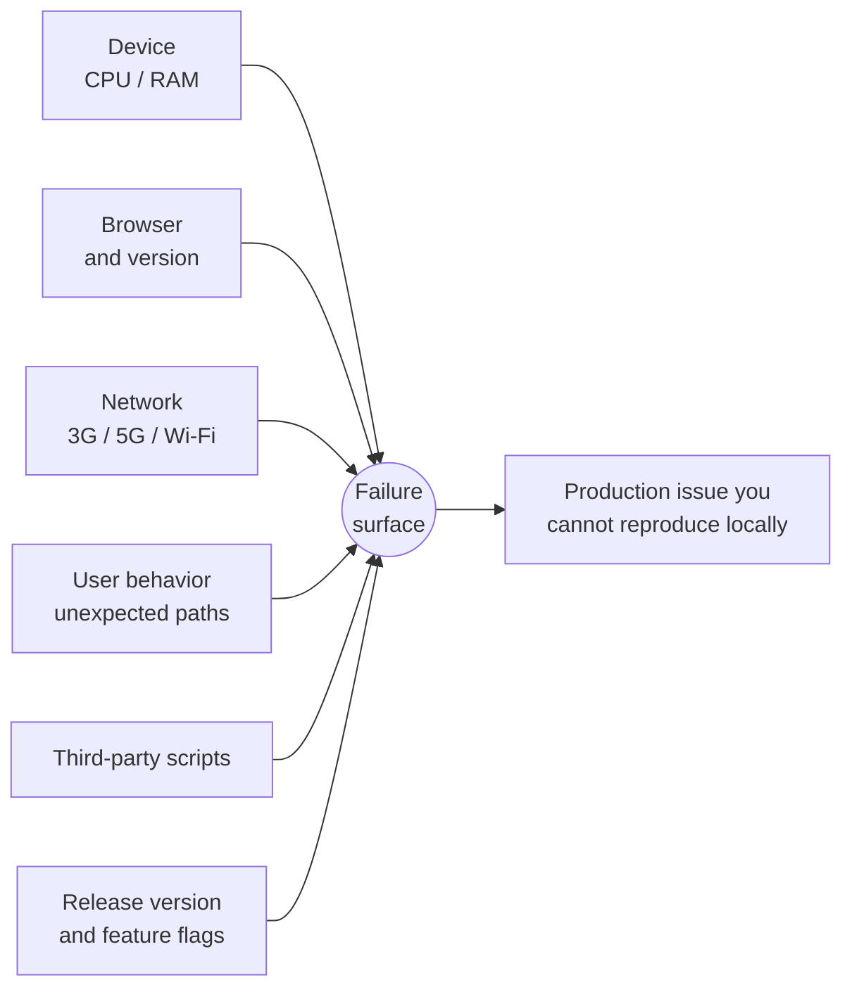

**Staff-Level Trade-offs and Corner Cases**

- You cannot test your way out of this. The answer is **telemetry from real users** plus the ability to slice it by device, browser, network, version and flag.
- A healthy backend does **not** imply a healthy product (see the network-failure example in [A4](#a4-error-monitoring)).

---

## A2. Monitoring vs Observability

**Core Concept and the Why**

|                   | Question it answers       | Nature                                                                                                                                                          |
| ----------------- | ------------------------- | --------------------------------------------------------------------------------------------------------------------------------------------------------------- |
| **Monitoring**    | _Is something wrong?_     | Constant watching of known signals: JS error rate, slow page load, API failure rate, crash rate, poor Core Web Vitals. You act when a signal goes out of range. |
| **Observability** | _Why is something wrong?_ | The ability to understand what is happening inside the app by analyzing external signals: what failed, where, why, who is affected, how often, how severe.      |

**The speaker's explicit guidance for interviews:** _do not over-differentiate the two._ Treat them as one mental model: **"There is a problem on production. How do I identify it, and how do I fix it?"** Monitoring is how you find out something has gone wrong; observability is how much information you have to fix it once you know.

**Underlying Mechanics**

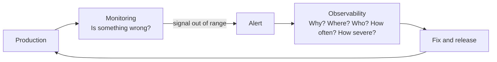

**Staff-Level Trade-offs and Corner Cases**

- Interviewers usually ask the _production bug story_ question ("tell me about a bug you found on production and how you fixed it"). The very first sub-question is **"how did you detect it?"** Have a concrete answer built on the signals in [A3](#a3-the-signal-map).
- Depending on the issue, you will use a **subset** of the signals: with a known runtime error you may not need behavior analytics; with a slow-but-working page you do not need error monitoring; with a healthy, fast page that users silently avoid, you need behavior tracking.

---

## A3. The Signal Map

The session covered five complementary signal types. Memorize this table, since it is the skeleton of any observability answer:

| #   | Signal                     | Answers                                                  | Typical tools mentioned                                                                                         |
| --- | -------------------------- | -------------------------------------------------------- | --------------------------------------------------------------------------------------------------------------- |
| 1   | **Error monitoring**       | Did something break?                                     | Sentry, Bugsnag, Rollbar                                                                                        |
| 2   | **Performance monitoring** | Is it fast enough for real users?                        | Lighthouse CLI, BrowserStack/Sauce Labs (synthetic); web-vitals package, Google reports, Google Analytics (RUM) |
| 3   | **User behavior tracking** | Is anyone actually using it, and where do they drop off? | Google Analytics, Mixpanel, Amplitude                                                                           |
| 4   | **Logging strategy**       | Can I trace one request or session end to end?           | Common logging function plus centralized platform (Grafana is common on the backend)                            |
| 5   | **Session replay**         | What exactly did the user do before the crash?           | LogRocket, FullStory                                                                                            |

On top of these sits **alerting** ([A9](#a9-alerting-strategy)), which converts signals into action.

---

## A4. Error Monitoring

**Core Concept and the Why**

Capture every kind of failure that can silently break the UI:

- JavaScript runtime errors
- Unhandled promise rejections
- Component crashes
- Network request failures

_Why it matters:_ a single unguarded failure can produce a blank screen, a broken feature, or a frozen UI. Speaker's examples: reading an array index that does not exist; destructuring a response where four values were expected but fewer came back and it was not guarded by `try/catch`. One bad access can crash an entire component and "nothing works after that point".

**The network-failure subtlety (important):** your backend can be healthy and the device healthy, yet the **network is slow**, so requests never reach the backend, or fail before they get there. The backend cannot see those failures. Only client-side monitoring can.

**Underlying Mechanics: what to capture**

A bare error message is almost useless. Speaker's principle: **"An error must include context,"** otherwise you cannot replicate or triage it quickly.

| Always capture                    | Why                                                                     |
| --------------------------------- | ----------------------------------------------------------------------- |
| Error message                     | First clue (for example "tried accessing an index that does not exist") |
| Stack trace                       | Where in the code                                                       |
| Component root / page / hierarchy | Which part of the UI tree                                               |
| Browser and operating system      | Safari-only or Firefox-only issues                                      |
| User session and network state    | Issues that only happen on 3G, never on 5G or Wi-Fi                     |
| User ID                           | Who is affected                                                         |
| Route                             | Which page                                                              |
| Feature flag(s)                   | Which variant they were in                                              |
| Release version                   | Which deploy introduced it                                              |

**Design pattern (speaker): one common logging function.** Do not scatter `Sentry.captureException(...)` calls with ad hoc payloads. Put a single function in a shared place that automatically attaches the common fields (user ID, app version, network type, route, flags) and takes only the _specific_ parameters from the call site (the error, a note).

```ts
// logger.ts: the single choke point for all error reporting
type ErrorContext = {
  feature?: string;
  note?: string;
  extra?: Record<string, unknown>;
};

export function logError(error: unknown, ctx: ErrorContext = {}) {
  const common = {
    userId: session.userId, // who
    sessionId: session.id, // which session
    appVersion: __APP_VERSION__, // which release
    route: window.location.pathname, // where
    flags: featureFlags.snapshot(), // which variant
    env: __ENV__, // prod / staging
    network: (navigator as any).connection?.effectiveType ?? "unknown",
    ua: navigator.userAgent, // browser + OS
    ts: Date.now(),
  };
  reporter.capture(error, { ...common, ...ctx }); // Sentry / Bugsnag / Rollbar
}

// usage at a call site: only the specific bits are passed
try {
  const [a, b, c, d] = await fetchFour();
} catch (e) {
  logError(e, {
    feature: "checkout",
    note: "fetchFour returned fewer than 4 items",
  });
}
```

**Diagram**

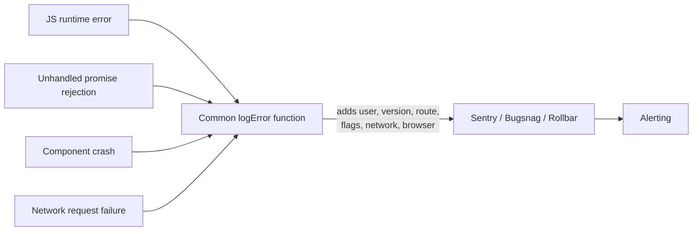

**Staff-Level Trade-offs and Corner Cases**

- **Tool choice is a cost and preference decision.** Different companies pick Sentry, Bugsnag, Rollbar, etc. depending on cost and preferences. In an interview, justify the choice rather than name-drop.
- **Centralize.** A common library or place from which all calls originate keeps payloads consistent and makes tool migration cheap.
- **Backend 5xx belongs to the backend team; client network errors belong to the client team.** Categorize before you log, because over-logging costs money (speaker's answer to a question about spikes in 5xx).
- **Staff addendum (not from the session):** scrub PII before sending; upload source maps so minified stacks are readable; sample or rate-limit noisy errors so one bad deploy does not blow your quota; and group errors by fingerprint so alerts count _distinct_ problems.

---

## A5. Performance Monitoring Synthetic vs Real User Monitoring

**Core Concept and the Why**

Your app may have **zero errors** and still lose users because it is slow. Performance monitoring tracks _how fast the app behaves for real users_:

- Page load time
- First contentful paint, Largest Contentful Paint (LCP)
- Interaction delay (INP)
- Rendering time
- API latency
- Core Web Vitals (covered in an earlier session)

Page load time is not formally part of Core Web Vitals, but if the others are healthy it usually follows, and you can still log it explicitly.

**Underlying Mechanics: two measurement modes**

|          | Synthetic monitoring                                                                                                                                                                                                               | Real User Monitoring (RUM)                                                                                                                       |
| -------- | ---------------------------------------------------------------------------------------------------------------------------------------------------------------------------------------------------------------------------------- | ------------------------------------------------------------------------------------------------------------------------------------------------ |
| What     | **Simulated** tests in controlled environments                                                                                                                                                                                     | Measurements from **actual users**                                                                                                               |
| How      | Run Lighthouse CLI against many virtual environments (different RAM, CPU, network). Big companies rent device farms (BrowserStack, Sauce Labs) with hundreds to thousands of device and network configurations running in parallel | `web-vitals` package that reports to your system; the periodic Web Vitals report Google gives you once your site is registered; Google Analytics |
| Strength | Catches regressions **before** users do; reproducible                                                                                                                                                                              | Ground truth. Reflects device, CPU, network speed, geography and browser, all of which keep changing                                             |
| Weakness | **Costly**: not every company can afford 1,000 to 2,000 parallel systems early on. Can never cover every real combination                                                                                                          | Arrives after users are already affected                                                                                                         |

**The speaker's verdict:** RUM is **critical** (and essential) because performance depends on device, CPU, network, geography and browser, all of which change constantly. Synthetic is a good complement if you can afford it.

**Diagram**

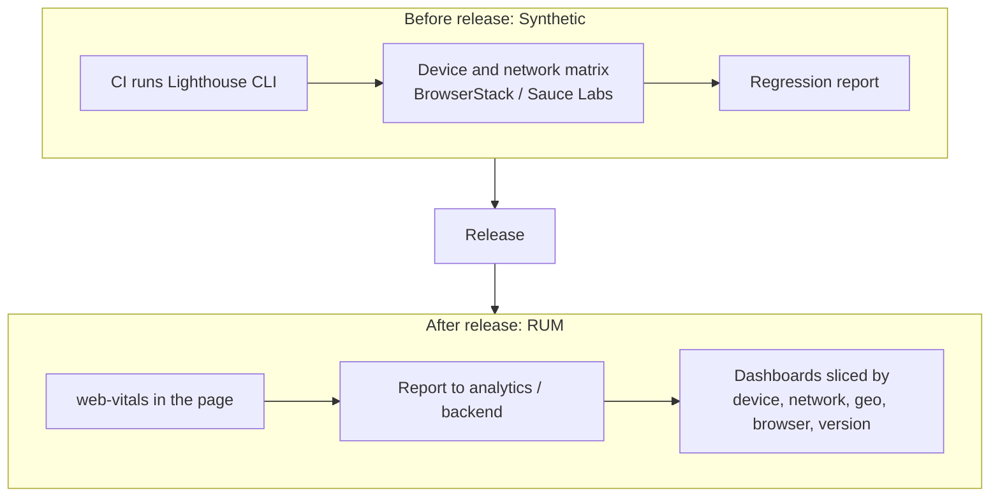

**Staff-Level Trade-offs and Corner Cases**

- Synthetic = _prevention_, RUM = _truth_. A mature setup uses both; a startup with limited budget leans on RUM plus a small synthetic matrix.
- **Staff addendum (not from the session):** report **percentiles (p75, p95)** not averages; tag every metric with release version so a regression maps to a deploy; use `navigator.sendBeacon` (or equivalent) so metrics survive page unload.

---

## A6. User Behavior Tracking and Funnels

**Core Concept and the Why**

No errors. Fast pages. Yet users are not using the product. Monitoring _behavior_ answers: **are real people actually using it, and where do they drop off?**

Track: clicks, navigation paths, feature usage, drop-off points, conversion events.

**The speaker's story (memorize; it is a strong interview anecdote):** at a big e-commerce company, orders suddenly dropped on the mobile app. There were **no errors**: APIs worked, the page loaded, payment worked. Because they tracked releases, they could pinpoint **which version** the drop began in. They pulled design, backend and frontend together in one room and compared changes. The root cause: the **Place Order button had moved from the bottom to the top** of the mobile screen. Most people use a thumb, so reaching the top was hard. They moved it back and orders recovered.

_Lesson:_ behavior metrics catch problems that no error tracker or performance tool can see, and **version-tagged analytics** are what let you bisect "which release caused this".

**Underlying Mechanics: the user funnel**

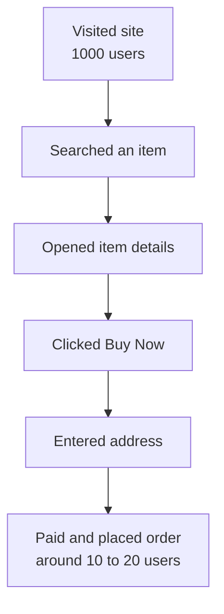

You measure the **drop between each step**. Speaker's own example: of everyone who visits his course site, only 1 to 2 percent become paid users. If the drop is just price, you cannot fix it. But often the drop is _something other than money_, and the funnel shows which step to investigate.

**Every new feature needs a success criterion (the speaker's most emphasized point in this section):**

Before building a feature, ask product: _why are we building this? is it must-have or nice-to-have? how will we know it succeeded?_ Example: adding **search** to Notion.

- The search **API** tells you how many searches were executed. It does **not** tell you how many users _found_ the search box and clicked it. **Discoverability** is measured by clicks on the entry point, not by API calls.
- Define a concrete target and make missing it an **alert**: _"One week after release, with a million users, I expect at least 10,000 people to have used search. If not, that itself is an alert. Then I investigate how far users get and why they do not click."_

**Discoverability and UX:**

- Even very good products have usability problems. Speaker's example: Notion's paid plan flow where a quoted price of 200 rupees becomes 550 because a hidden yearly/quarterly checkbox changes the total, and the user cannot tell why. For the developers the feature is easy to find; for an end user it is hard.
- **"The moment you start explaining your UX or design to someone (at least in a B2C product), you have lost the game."** If users cannot discover a feature by themselves, they will most likely not use it.
- Tools: Google Analytics, Mixpanel, Amplitude. (The speaker tracks clicks like "enroll for cohort" and article opens on his own site via Google Analytics, without forcing logins, to decide what content to create.)

**Staff-Level Trade-offs and Corner Cases**

- **Instrument at the entry point, not just the API.** A feature can be "working" (API healthy) and "failing" (nobody clicks).
- **Tag every event with release version and experiment/flag**, so you can compare version N against N-1 (this is what solved the order-drop story).
- **Staff addendum (not from the session):** pair behavior metrics with A/B experiments; watch **guardrail metrics** (error rate, latency) while a feature rolls out; respect consent and privacy regulations for analytics.

---

## A7. Logging Strategy and Correlation IDs

**Core Concept and the Why**

You will collect a lot of data. A **logging strategy** makes it queryable and actionable.

**Log levels (speaker):** Information, Warning, Error, Debug.

- **Information:** you can mostly ignore; no action needed.
- **Error and debug:** the ones to act on (the speaker grouped these as the actionable bucket).
- _Staff addendum (not from the session):_ in most production setups, debug logs are verbose and disabled or sampled in prod; the actionable severities are usually warning and error. Be ready to state your own convention.

**Fields to log on every event:** user **session ID**, **correlation ID**, **feature name**, **timestamp**, **environment** (plus app version, per the best-practices list).

**Correlation ID, explained (speaker):** a request may pass through several backends: frontend, backend A, backend B, and so on, and the result comes back to the client. Assign **one unique ID per request** and pass it to every system it touches. Later you can trace exactly how far it got and where it failed.

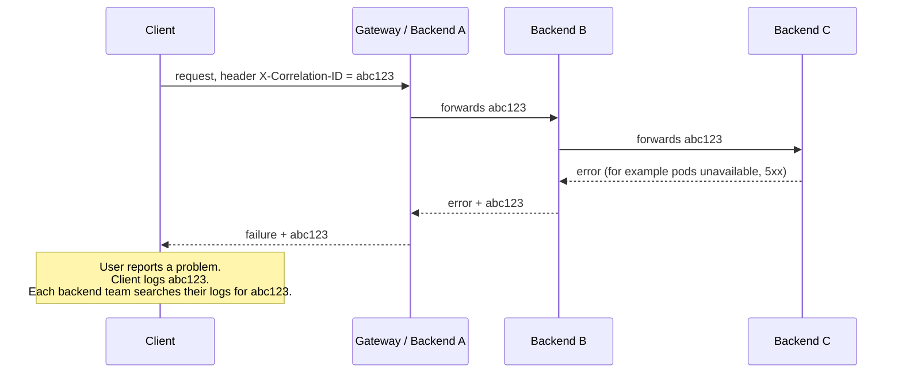

**Why this matters in practice:** when a user reports an issue and the client shows only a failure, you hand the correlation ID to backend teams. One may reply, "backend was down, pods were not available, so a 5xx came back"; another may say, "mine is fine, check the next system". You find the faulty hop quickly instead of guessing.

**Staff-Level Trade-offs and Corner Cases**

- Generate the ID **on the client** (or at the edge) so even requests that never reach a backend are traceable on the client side.
- **Structured logging** (key-value JSON, not free text) is what makes fields like correlation ID searchable. See [A10](#a10-observability-best-practices-and-when-to-invest).
- **Staff addendum (not from the session):** an industry standard exists for propagating this (the W3C `traceparent` header used by distributed tracing systems like OpenTelemetry); mentioning it shows you know the ecosystem.

---

## A8. Session Replay

**Core Concept and the Why**

Session replay records the user's session leading up to a crash (clicks, scrolls, DOM changes, console errors), and ships a short "video" to a dashboard. Tools: **LogRocket, FullStory**. It gives a complete picture of why an error happened and looks like the easiest route to debug.

**The speaker's stance: use it sparingly. It should be among the _least_ of your observability investments.** Why:

- You must **capture continuously in anticipation of failure**, because you do not know in advance which session will crash.
- There is processing involved (recording events and the screen, sending to a backend). Even if some of it is off the main thread, it still has a cost.
- So use it **only on critical flows**. Example: in an e-commerce app, users who arrive but do **not** place an order is the crux of the business, a strong case for replay. A user going to Settings and not changing anything should **not** be recorded.

**Staff-Level Trade-offs and Corner Cases**

- **Cost vs value:** replay is a high-cost, high-detail tool. Reserve it for revenue-critical or high-severity flows.
- **Staff addendum (not from the session):** privacy is the main risk (passwords, payment fields, PII). Mask inputs by default, exclude sensitive screens, and honor consent. Also sample sessions rather than recording 100 percent.

---

## A9. Alerting Strategy

**Core Concept and the Why**

You cannot have someone staring at a dashboard 24/7, and some failure is normal (for example 1 in 100 requests fails). So you need **alerts**: automated notifications when a metric crosses an agreed threshold, at midnight or early morning if need be, to the right people.

> **The speaker flagged this as a high-yield interview area.** In system design interviews you are often asked about a production bug you found and fixed, and the very first follow-up is _how did you detect it?_ A solid alerting answer is your reply.

**Underlying Mechanics**

### Thresholds, with the speaker's examples

| Metric        | Example threshold         | Who should be alerted                                                                |
| ------------- | ------------------------- | ------------------------------------------------------------------------------------ |
| Error rate    | greater than 5 percent    | Backend team for server errors; **frontend team too** if client-observed errors rise |
| API latency   | spike beyond agreed bound | **Client** must track its own request-response time                                  |
| Page load     | beyond 4 seconds          | Frontend team                                                                        |
| Feature crash | any crash detected        | Owning team                                                                          |
| Memory usage  | spike in production       | On-call (even at night)                                                              |

### Why the _client_ must alert even if the backend already does

1. **Error rate.** Suppose the agreed acceptable error rate is 5 percent (for example some pods are not up). If the backend sees it cross 5 percent, the backend team is alerted. Now suppose the frontend sees **10 percent**. The extra failures may not be a backend cause at all. Speaker's example: a hurricane or natural disaster knocks out internet for a large user base. Requests fail before reaching your servers, so the backend cannot see them. Only the client notices (logs may flush later when connectivity returns).
2. **Latency.** Many people assume the backend can measure latency. It cannot measure what the user experiences. The backend might respond in 200 ms, but the client will see more because the request crosses multiple layers: the user's Wi-Fi or mobile network, the ISP, API proxies/gateways, and back. **Client delay is always greater than backend delay**, so the client must track request-to-response time and debug on its own side when it exceeds the budget.

### How do you derive "5 percent"?

You **cannot** know on launch day because there are no logs.

1. Launch and **observe** for a period (one week, one month, up to a few months).
2. Learn the **usual** rate and the pattern. Example: it stays near 5 percent week over week, caused by poor user networks and unavoidable backend downtime (no cloud provider offers 100 percent availability).
3. Decide what is "safe" for your product. The threshold can be a **percentage** or an **absolute number** (for example a page-load time).
4. Configure the alerts.

### Delivery and quality

- Logging tools integrate with **alerting/paging tools** (PagerDuty, xMatters; the recording transcribes the latter as "Xmatter"). These only handle **delivery**: phone call, email, Slack, Microsoft Teams. The logic of _when_ to alert is your responsibility.
- Route by severity: **non-critical to Teams/Slack, critical to a phone call.**
- A good alert is **actionable** (not merely "known"), **severity-classified** (P0, P1, P2, P3) and **routed to the correct team**. The speaker's test: if a 2 a.m. call is not actionable, you will regret having created it.
- In good companies **developers themselves design the alerting strategy** for their apps.

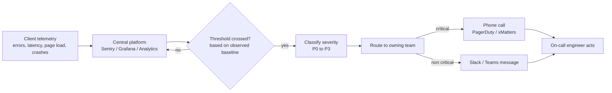

**Staff-Level Trade-offs and Corner Cases**

- **Alert fatigue** is the failure mode of over-alerting. Non-actionable alerts train people to ignore the one that matters.
- **Day-one blindness:** until you have baseline data you cannot set data-driven thresholds. Start with conservative guesses and refine.
- **Dedicated ownership:** for a B2C product, someone should actively own this. Speaker: have an **on-call rotation** (for example weekly) on the frontend team.
- **Pages and spikes:** a _sudden spike_ in a metric over a short span is a classic alert trigger. First decide whether it is a backend or client problem, because over-logging costs money.
- **Staff addendum (not from the session):** consider alerting on **rate of change** or error-budget **burn rate** instead of raw thresholds; add alert deduplication and silencing; write a runbook link into every alert.

---

## A10. Observability Best Practices and When to Invest

**Best practices (speaker's list)**

| Practice                                      | Why                                                                                                               |
| --------------------------------------------- | ----------------------------------------------------------------------------------------------------------------- |
| **Centralized monitoring platform**           | One place to look, consistent tooling                                                                             |
| **Structured logging format**                 | Machine-searchable fields                                                                                         |
| **Version tagging on every event**            | Pinpoint which release has the problem                                                                            |
| **Environment tagging**                       | Separate prod from staging                                                                                        |
| **Graceful failure in the monitoring itself** | The telemetry code must never crash the app                                                                       |
| **Monitor non-production too**                | You often catch issues in demo/staging before prod. Non-prod should be _monitored_ but typically not _alerted_ on |

**Major things to monitor:** runtime errors, network failures, user flows, feature usage, memory usage, and anything else that is important to the business.

**When to invest heavily:** large user base, revenue-sensitive flows, real-time applications, multiple teams owning the product, third-party integrations. Speaker's generalization: **B2C companies invest far more in observability than B2B**, since B2B products often have smaller, known user bases and direct support channels.

**Who does it:** a dedicated frontend team or on-call rotation watches these signals. The speaker's example: a release looks fine, and in the middle of the night a memory spike appears in production; someone has to wake up, diagnose and fix it.

---

## A11. Part A Interview Drills

**Drill 1. "Orders dropped 20 percent on mobile after a release. No errors anywhere. What do you do?"**
Answer shape: confirm via **version-tagged funnel analytics** which release introduced the drop; compare the funnel step by step to find where users fall off; involve design, backend and frontend to diff the changes; hypothesize UX causes (button placement, discoverability), not just technical ones; fix and verify the funnel recovers. Cite the bottom-to-top Place Order story.

**Drill 2. "Backend dashboards are green, but users report failures. Explain."**
Answer shape: failures can occur before requests reach the backend (poor or broken network). Only client-side telemetry sees them. Check client error and latency metrics sliced by network type, region and browser. Mention the hurricane example and why client delay always exceeds backend delay.

**Drill 3. "How would you decide the error-rate threshold for an alert?"**
Answer shape: you cannot on day one. Observe for weeks to months, learn the steady-state baseline and its causes, choose a tolerance (percentage or absolute) for your product, then configure alerting. Route severity and make every alert actionable.

**Drill 4. "You shipped a Search feature. How do you know it worked?"**
Answer shape: define success criteria **before** building. Measure discoverability (clicks on the search entry point), not only API calls. Set a target (for example 10,000 of 1,000,000 users within a week) and alert if missed; then investigate the funnel.

**Drill 5. "Should we turn on session replay everywhere?"**
Answer shape: no. It has a continuous capture cost and privacy exposure. Use it on revenue-critical flows (checkout drop-off), not on settings pages.

---

# Part B. Designing an Autocomplete Typeahead System

> **Speaker's framing:** "Systems that look simple have so much associated with them." The user types in a search box; the system shows suggestions they can pick from. The session scoped this to the **search box and its suggestions**, not the full results page.
>
> Recommended reading from the speaker: the free GreatFrontEnd article on typeahead (it also covers the news feed, which is the next session).

---

## B1. Problem Framing and Requirements

**Core Concept and the Why**

The speaker's interview technique: **do not start designing. Start by building a requirements list**, split into _functional_ and _non-functional_. He deliberately gave only the one-line problem and asked the room to produce the requirements.

- **Functional requirement:** something the user directly uses (searching, seeing results, results containing text or text plus images).
- **Non-functional requirement:** performance, caching, accessibility, internationalization, globalization, and so on (the same family as Web Vitals).

**Requirements gathered in the session**

| Functional                                      | Notes from the discussion                                                                                              |
| ----------------------------------------------- | ---------------------------------------------------------------------------------------------------------------------- |
| Search with suggestions                         | The core flow: input is the search key, output is the suggestion list                                                  |
| Result content                                  | Text only, or text plus images? (images and their optimization are deferred to the news feed session)                  |
| Handle **no results**                           | Empty state                                                                                                            |
| Handle **API failure / error / warning** states | Distinct from "no results"                                                                                             |
| **Keyboard navigation**                         | Arrow keys, Enter                                                                                                      |
| **Highlight the matching text**                 | Bold or color the typed prefix inside each suggestion                                                                  |
| **Single select / multi-select**                | Checkbox style multi-select was raised                                                                                 |
| **Minimum characters** to start searching       | Example used later: 3 characters                                                                                       |
| **Debouncing**                                  | Example used later: 250 ms                                                                                             |
| **Nested / segmented results**                  | A product that exists in two categories (for example a phone under both "Samsung" and "Mobiles") should appear in both |
| **Trending searches**                           | Click into the empty search box and see what is trending                                                               |
| **Recent search history**                       | Shown when input is empty                                                                                              |
| **Voice search**                                | Raised and added                                                                                                       |
| **Cancel previous request**                     | Raised by the room; examined in [B6](#b6-race-conditions-and-out-of-order-responses)                                   |
| AI summary section                              | Suggested, but the speaker scoped it out: this session is about the search box, not the results page                   |

| Non-functional                 | Notes                                                                     |
| ------------------------------ | ------------------------------------------------------------------------- |
| **Caching**                    | The one NFR that is specifically valuable here, and the focus of B3 to B5 |
| Performance                    | Fast suggestions are the whole point                                      |
| Globalization and localization | Languages, scripts                                                        |
| Security                       |                                                                           |
| Alerting and monitoring        | Ties back to Part A                                                       |
| Accessibility                  |                                                                           |
| Responsiveness                 |                                                                           |
| **Rate limiting**              | Do not hammer the backend on every keystroke                              |

**The speaker's tactic:** he _grouped_ many requirements under one heading ("primarily related to search") rather than writing ten separate lines, and he said he would not spend much time on common NFRs because they are the same for every system. Spend your time on the ones specific to the problem (here: caching).

_Note: a couple of items in the recording were unintelligible (for example a line that sounded like "conflict handling"), so they are not elaborated here._

**Staff-Level Trade-offs and Corner Cases**

- Min characters and debouncing are **client-side load shedding**. They reduce requests, but they do **not** eliminate duplicates or ordering problems, which is why the rest of Part B exists.
- **Staff addendum (not from the session):** accessibility for comboboxes is its own sub-problem (ARIA combobox/listbox roles, announcing result counts to screen readers, IME composition events for languages like Japanese).

---

## B2. Baseline Architecture and Iterative Layering

**Core Concept and the Why**

The speaker's method, and the one he wants you to copy in interviews: **draw the simplest thing first, then add one layer at a time**, explaining what each addition buys and what it costs.

**Step 0, the naive design**

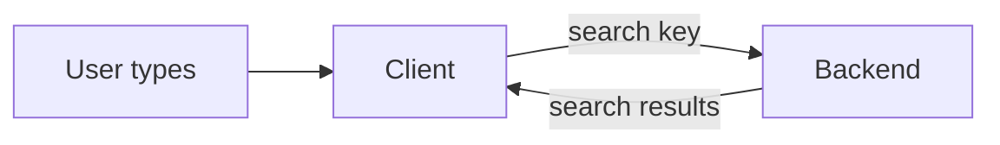

Input = search key. Outcome = search results. The backend may return personalized or generic results.

**Step 1, already in place (assumed hypothetically):** minimum character threshold (say 3) and debounce (say 250 ms). These are baseline hygiene.

**Step 2, the question to the room:** _as an architecture pattern (not at the component level), what else improves the time for the user to see results?_ The first answer from the room, and the correct one: **cache the results**, adding a layer between the typing and the backend.

**Step 3, the design with a cache layer**

Both "user typing" and "cache" sit on the **client side**; the backend is the other side.

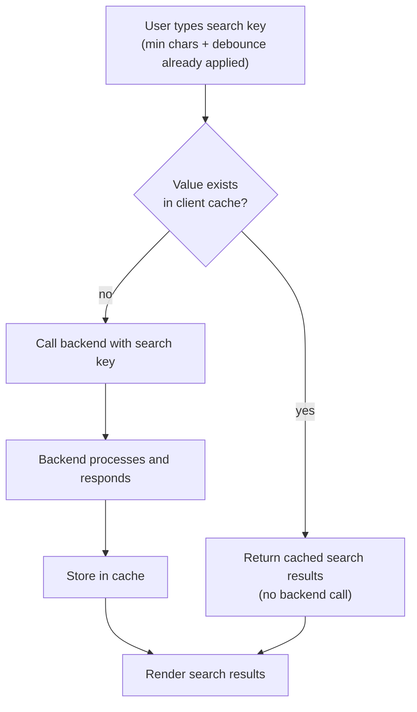

**Staff-Level Trade-offs and Corner Cases**

- Each new layer introduces new failure modes. The speaker immediately turned to them: duplication, memory, staleness, and the separate problem of race conditions.
- **Diagramming hack from the speaker:** in Excalidraw-like canvas tools, if you add a _background layer or grouping box on top_, editing the elements underneath becomes painful. **Do not add those grouping layers until the design is finalized.** Draw quickly (use a mouse if you can), and narrate your technique as you go.

---

## B3. Client Side Cache Design

**Core Concept and the Why**

A cache turns repeat or overlapping typing into zero-latency, zero-cost responses. The speaker built it up from the room's suggestion (a key-value pair) and then stress-tested it.

**Underlying Mechanics: first version, key to results array**

- **Key** = the search string typed.
- **Value** = the list of results the backend returned.
- Each result should carry more than text: at least **`text` and an `id`**, because later the `id` can be passed to the search component or API to fetch a better result. (The speaker said to assume extra fields exist depending on how you architect the system.)

```json
{
  "how": [
    { "id": 1, "text": "how to cook" },
    { "id": 2, "text": "how to fly" },
    { "id": 3, "text": "how to eat" },
    { "id": 4, "text": "how are you?" }
  ],
  "how to": [
    { "id": 1, "text": "how to cook" },
    { "id": 2, "text": "how to fly" },
    { "id": 3, "text": "how to eat" }
  ]
}
```

Observe what changes as the user types: for `how`, the backend might return "how are you?" too; for `how to`, "how are you?" is no longer relevant. The user may keep typing (`how to cook`) and get still different results, or choose a suggestion outright.

```ts
// Minimal cache-first lookup
const cache = new Map<string, Suggestion[]>();

async function getSuggestions(query: string): Promise<Suggestion[]> {
  const hit = cache.get(query);
  if (hit) return hit; // no network call

  const res = await fetch(`/api/suggest?q=${encodeURIComponent(query)}`);
  const data: Suggestion[] = await res.json();
  cache.set(query, data); // populate on miss
  return data;
}
```

**The speaker's stress test: "Do you see a problem with this?"** Answers from the room and his commentary:

| Problem            | Verdict                                                                                                                                                                               |
| ------------------ | ------------------------------------------------------------------------------------------------------------------------------------------------------------------------------------- |
| **Duplicates**     | Correct. The same result (for example "how to cook") is stored under `how`, `how to`, `how to c`, etc.                                                                                |
| **Memory bloat**   | A direct consequence of duplication                                                                                                                                                   |
| **Stale data**     | A real problem if you cache forever. Example: a flagship phone launches today at 5 p.m. A search before 5 p.m. returned nothing; cache it, and users still see no result after launch |
| **Race condition** | Real, but it is **not a caching problem**. It is a request-ordering problem, handled in [B6](#b6-race-conditions-and-out-of-order-responses)                                          |

**Staff-Level Trade-offs and Corner Cases**

- **Cache key normalization:** the key must be canonical (trim, lowercase, collapse whitespace, Unicode normalization) or `How` and `how` become two entries.
- **Unbounded growth:** the speaker did not cover eviction by size; **Staff addendum (not from the session):** cap the entry count and evict least-recently-used.
- **Negative caching** (caching "no results") is exactly what hurt in the 5 p.m. launch example, so give empty results a short TTL.

---

## B4. Cache Expiration and Staleness

**Core Concept and the Why**

"Definitely there should be a cache expiration policy." A cache without expiry guarantees staleness, which in e-commerce means showing outdated catalogs.

**Underlying Mechanics: the policies the speaker described**

| Policy                            | How it works                                                                                                              | When it fits                                   |
| --------------------------------- | ------------------------------------------------------------------------------------------------------------------------- | ---------------------------------------------- |
| **Global TTL**                    | Keep the whole cache for a fixed period (for example one hour); after that delete everything                              | Simple, predictable, data changes slowly       |
| **Per-entry timestamp (and TTL)** | Store an added-at timestamp per key. One key may live an hour, another only 15 minutes                                    | Different freshness needs per query type       |
| **Session boundary**              | If the user kills the session and reopens, and the TTL has elapsed, clear everything and start fresh                      | Prevents resurrecting old data across sessions |
| **Repeat-search invalidation**    | If the user searches the **same key twice**, they are probably unsatisfied and want new results, so invalidate that entry | Behavior-driven freshness                      |

> **Speaker's decision rule:** the right policy depends on the **product** and on **how often the underlying data can change**. There are many add-ons; the goal is to give the user the best results while still caching.

```ts
type Entry = { value: Suggestion[]; addedAt: number; ttlMs: number };
const TTL_DEFAULT = 60 * 60 * 1000; // 1 hour

function readCache(key: string): Suggestion[] | null {
  const e = store.get(key);
  if (!e) return null;
  if (Date.now() - e.addedAt > e.ttlMs) {
    store.delete(key);
    return null;
  } // expired
  return e.value;
}
```

**Staff-Level Trade-offs and Corner Cases**

- **Freshness vs speed** is a product decision, not a technical one. Defend it by naming what changes and how often.
- **Staff addendum (not from the session):** consider _stale-while-revalidate_ (serve cached instantly, refresh in the background); this was discussed in the earlier storage session for feeds and applies here too.

---

## B5. Normalized Cache

**Core Concept and the Why**

The plain key-to-array design duplicates the same result under many keys. The speaker presented a **normalized map of results**, taken from the GreatFrontEnd article, as a more optimal variant.

**Underlying Mechanics**

The idea: the **same result can legitimately belong to multiple queries**. His example: searching `FA` where a result like **Facebook** exists in more than one place (index 1 and index 2), another entry like **Fast Track**, and another like **Face** (at index 3). Instead of storing full copies per query, store each distinct result **once**, and let queries reference them. When `FA` is searched, you look across those cached entries and assemble the result list from them. He called it **slightly more optimal than a plain key-value hash**.

```ts
// Normalized: each suggestion stored ONCE, queries just point to ids
const entities = new Map<number, Suggestion>(); // id -> { id, text, ... }
const queryIndex = new Map<string, number[]>(); // "fa" -> [1, 2, 3]

function put(query: string, results: Suggestion[]) {
  results.forEach((r) => entities.set(r.id, r)); // dedupe by id
  queryIndex.set(
    query,
    results.map((r) => r.id),
  );
}

function get(query: string): Suggestion[] | null {
  const ids = queryIndex.get(query);
  return ids ? ids.map((id) => entities.get(id)!) : null;
}
```

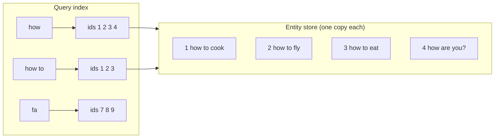

**Staff-Level Trade-offs and Corner Cases**

- **Pros:** less memory, a single place to update or invalidate an entity, and shared objects.
- **Cons:** more bookkeeping; deleting an entity requires reference awareness; slightly more complex code than a `Map`.
- **Interview framing:** start with the simple key-value cache, name its duplication problem, _then_ offer normalization as the evolution. That shows you reason from problems to solutions.

---

## B6. Race Conditions and Out of Order Responses

**Core Concept and the Why**

This is the most interview-relevant problem in the typeahead question. The speaker stressed: **"This is not a hypothetical scenario. This is a very practical scenario."**

**The scenario**

The user types quickly and three requests go out:

1. Request 1: `how`
2. Request 2: `how to`
3. Request 3: `how to cook`

Network responses do **not** have to arrive in the order they were sent. Suppose Response 1 (for `how`: "how to marry, how to fly...") arrives **last**. The search box says `how to cook`, but the UI renders suggestions for `how`. The user sees irrelevant results, and "the user immediately stops using the site". The product has defeated its own purpose.

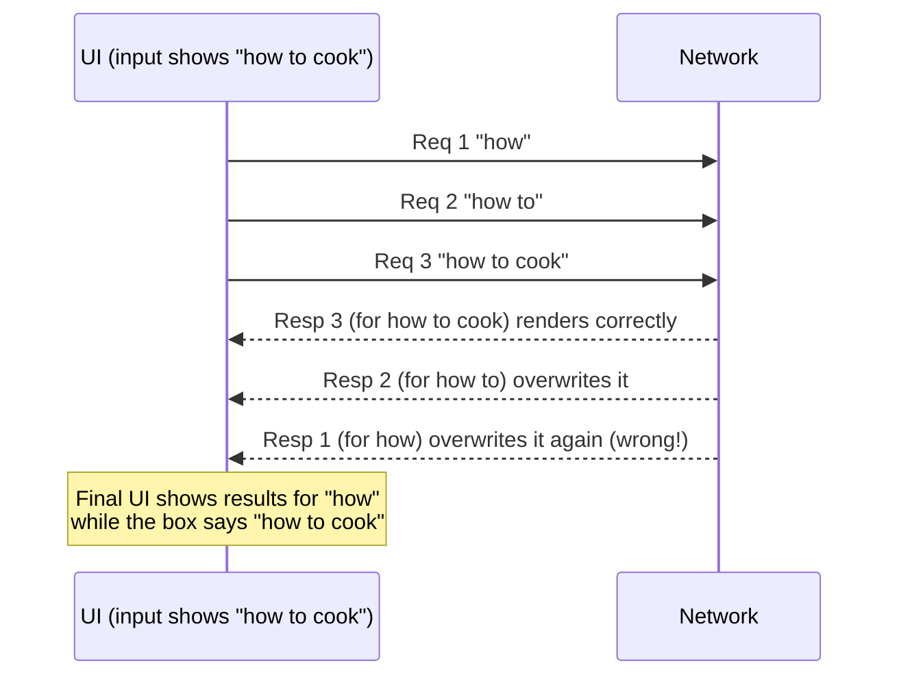

**Why debouncing alone does not fix it:** the speaker's point: even with debouncing in place, you can still have overlapping in-flight requests with different latencies, so the scenario remains possible.

**The solutions discussed, and the speaker's verdict on each**

| Approach                                       | Idea                                                                                                                   | Speaker's verdict                                                       |
| ---------------------------------------------- | ---------------------------------------------------------------------------------------------------------------------- | ----------------------------------------------------------------------- |
| **Debounce / delay**                           | Fewer requests                                                                                                         | Helps, but does not prevent the race                                    |
| **Abort previous request** (`AbortController`) | When a new request starts, cancel the earlier one                                                                      | See nuance below. Acceptable as a _byproduct_, **not a design pattern** |
| **Compare response query vs current input**    | On response, check that it matches the current text; otherwise ignore (and cache it)                                   | Right idea, but fragile (see below)                                     |
| **Timestamp / sequence of the latest request** | Tag each request with when it was made; render only the response belonging to the **latest** request; cache the others | **The slightly more optimal approach**                                  |

**The speaker's nuance on aborting (important, very interview-worthy):**

> _"There is nothing called true aborting."_ Once the request has been sent, it has reached the server; the server may already have processed it and the response may already be on its way. The client cannot un-send it (unless you make _another_ call to stop a long-running job). **All you can do is ignore the response.** So do not treat "abort" as your natural design instinct, just as memoization should not be your natural instinct. It can come as a byproduct, but do not reach for it as the design.

(What `AbortController` does in practice: when a newer request starts, you tell the client not to honor the earlier one's result. The speaker affirmed that modern libraries and `fetch` support this, while insisting you understand it is client-side discarding.)

**Why plain string comparison is fragile:** you sent `how to`; by the time its response returns the user has typed `how to c`. If you strictly require `response.query === input.value`, you may reject _every_ response and **show no results at all**, which is worse than slightly lagging results.

**The timestamp approach in detail (the speaker's worked example):**

- Request A made at 9:10, request B at 9:11, request C at 9:12 (illustrative; he said a real delay would not be this large).
- The **latest request** is the 9:12 one. Only the response tied to the 9:12 request is rendered.
- Responses for earlier requests are **not shown**, but are **stored in the cache** for later reuse.
- Result: you always honor the most recent intent, with possibly a small mismatch against the very latest keystroke, which is far better than showing nothing or showing wrong results.

```ts
let latestRequestId = 0;

async function onQueryChange(query: string) {
  const myId = ++latestRequestId; // monotonic stamp for THIS request
  const results = await getSuggestionsFromNetwork(query);

  cache.set(query, results); // always cache; never wasted work
  if (myId !== latestRequestId) return; // a newer request exists: do not render
  render(results); // only the latest request paints
}
```

**Staff-Level Trade-offs and Corner Cases**

- **Cache everything, render only the latest.** This keeps the benefit of late responses (they populate the cache) without letting them corrupt the UI.
- **Prefer a monotonic counter over wall-clock time** for the stamp (clock adjustments cannot break ordering). The speaker used timestamps for illustration.
- **Combine** the latest-request guard with `AbortController` as a bandwidth optimization, but make correctness depend on the guard, not the abort.
- **Staff addendum (not from the session):** in React, the same logic lives in an effect cleanup (`let ignore = false; return () => { ignore = true }`), or you can use a data-fetching library that implements it. The guard also solves late responses after a component unmounts.

---

## B7. Remaining Functional Features

Items from the requirements list that were discussed briefly:

- **Voice search.** Browsers and client libraries can convert speech to text **without any backend**; once you have text, it feeds the same search flow. The speaker saw no major design challenge (it is functionality, not architecture). Most modern B2C apps already offer it.
- **Highlighting matching text, keyboard navigation, single/multi select.** UI-behavior features, to be handled at implementation time (for example in a machine-coding round).
- **Images in results.** Deferred to the news feed session, which covers image optimization in depth.
- **Trending and recent searches.** Shown when the input is empty or focused; trending usually comes from the backend, recent history from the client.
- **Rate limiting.** Protects the backend from per-keystroke traffic; works together with min-characters and debounce.
- **API contract.** For _small_ problems such as autocomplete, an interviewer may ask for the API contract (what you send and what you expect back). For a _large_ product like Code Sandbox, it is impractical because there are too many APIs.

---

## B8. Part B Interview Drills

**Drill 1. "Walk me through designing autocomplete."**
Requirements (functional and non-functional, scoped to the search box) → naive client/backend diagram → min chars and debounce → add client cache with key-to-results (text and id) → name its problems (duplicates, memory, staleness) → expiry policy → normalization → race condition and the latest-request guard.

**Drill 2. "The suggestions flicker to wrong results for fast typists. Why and how do you fix it?"**
Out-of-order responses overwriting newer state. Fix with a latest-request guard (stamp or counter), cache all responses, render only the latest. Mention that abort is a byproduct, not the solution, and that strict string equality can leave the UI empty.

**Drill 3. "A phone launches at 5 p.m. Users who searched at 4:55 still see nothing at 5:05."**
You cached a negative or outdated result without a TTL. Add per-entry expiry (short TTL for empty results), invalidate on repeat search, and clear on session boundary.

**Drill 4. "Why not just abort the previous request?"**
Because the request has already left; the server may have processed it and the response is in flight. The only real action is to ignore the response. Use abort to save bandwidth, but guarantee correctness with the latest-request check.

**Drill 5. "How would you reduce duplicate storage in the cache?"**
Normalize: one entity store keyed by id, and a query index mapping each query to ids.

---

# Part C. Designing a Code Sandbox (Online Code Editor)

> **Speaker's framing:** a product like CodeSandbox is too big to design in one breath, so you **decompose it into numbered problems** and solve them one by one: (1) the editor, (2) the file explorer, (2A) saving code, (3) executing code, (4) editing and syncing. Interviews reward this decomposition more than any single clever answer.

---

## C1. Requirements and Screen Layout

**Functional requirements gathered from the room**

| Requirement                                 | Notes                                                                                        |
| ------------------------------------------- | -------------------------------------------------------------------------------------------- |
| Code editor                                 | Edit code across popular **languages and frameworks**                                        |
| Folder structure / file explorer            | Create, cut, delete files and folders; icon depends on file type                             |
| Programming language selection              | Different languages execute differently (React vs Java)                                      |
| Autosave                                    | Persist changes periodically                                                                 |
| Add HTML, CSS, React, etc.                  | Multi-file projects                                                                          |
| **Syntax highlighting**                     | Keywords colored per language                                                                |
| **Autocomplete** (suggestions)              | Speaker clarified: this is _not_ an AI feature (see [C7](#c7-editor-autocomplete-mechanics)) |
| Syntax errors and debugging                 | Show errors and a **console view**                                                           |
| Output / preview                            | How the result is shown                                                                      |
| Run and submit                              |                                                                                              |
| Version control integration                 | Git (not discussed in depth)                                                                 |
| Settings and preferences                    | Dark or light theme, etc.                                                                    |
| Shareable link                              | Unique link to a project                                                                     |
| Public / private                            | Visibility control                                                                           |
| Authentication and authorization            | Common to every product, handled separately                                                  |
| Code download                               |                                                                                              |
| Offline support                             | Deferred to the Google Docs session                                                          |
| **Concurrent editing / live collaboration** | Multiple people editing the same file; deferred to the Google Docs session                   |
| AI tools                                    | Raised, not discussed                                                                        |
| Adding libraries                            | A packages panel (npm style)                                                                 |

**Non-functional:** caching and performance matter; accessibility is the same as everywhere. Responsiveness is **less critical** here, since people rarely code on a phone (speaker's analogy: like Jira, which need not be fully mobile responsive).

**Underlying Mechanics: the screen**

```
+----------------------+------------------------------+----------------------+
|  FILE EXPLORER       |        CODE EDITOR           |   OUTPUT / PREVIEW   |
|  app/                |  syntax highlighting         |  React: rendered UI  |
|   src/               |  indentation                 |  Java: console logs  |
|    hooks/            |  autocomplete suggestions    |                      |
|  container/          |                              +----------------------+
|                      |                              |   CONSOLE / ERRORS   |
|  [ + libraries ]     |                              |                      |
+----------------------+------------------------------+----------------------+
```

The output pane **varies with the language**: for React you run the code and show the UI; for Java you show the logs/output. The speaker kept the diagram minimal (no terminal or user settings) for a "very simple code editor".

**Staff-Level Trade-offs and Corner Cases**

- State the scope you are _not_ solving (Git, AI tools, auth) so the interviewer sees you prioritizing.
- Pick the **hardest, most architectural problems** (execution, sync, file storage) for depth; skip commodity features.

---

## C2. Problem 1 The Editor Itself

**Core requirement:** edit code across all popular languages and frameworks, with **syntax highlighting** and **autocomplete**.

**Core Concept and the Why**

> **Speaker's answer: use an open-source editor such as Monaco or CodeMirror. Do not build it.** _"Unless we have years to build, one should not be reinventing the wheel."_

Why building one is a trap. A real code editor must handle, per language:

- **Syntax highlighting:** each language has its own keywords, each needing a color.
- **Indentation rules:** Python uses leading whitespace as structure; Java and JavaScript use braces. Pressing Enter should indent differently per language.
- **Syntax validation:** for example a missing semicolon is an error in one language and fine in another.
- **Autocomplete.**

**If a constraint forbids open source (speaker's thought process):** build around a **manifest file per language** that declares:

- the language's **keywords**,
- the **color** for each keyword (for example `var` and `let` in blue, `function` in dark blue),
- the **indentation rule** (what Enter and Tab do; illustrative per-language widths),
- other editor rules.

When a user selects a language, the editor **injects that manifest** and a **render engine** reads it and applies the rules while the user types. The speaker was explicit that a manifest alone will not run code or enforce rules; implementation is deep, and in an interview your _recommendation_ is to use Monaco or CodeMirror.

**Underlying Mechanics**

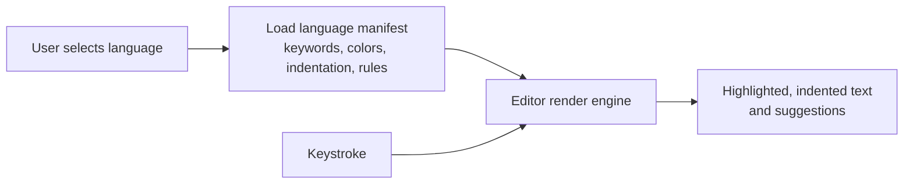

Because each language's keyword set is **finite and stable** ("unless the language changes, the keyword count will not change"), keyword recognition is a lookup against the manifest, not a guess.

**Staff-Level Trade-offs and Corner Cases**

- **Build vs buy:** building has near-zero upside for a product whose differentiator is something else; buying (Monaco, CodeMirror) gives you highlighting, indentation, bracket matching and completion for free, plus ecosystem support.
- **Legit reasons to build:** a policy that forbids third-party code, extreme bundle-size limits, or a very narrow language. In all other cases, defend "buy".
- **Staff addendum (not from the session):** license, bundle size, accessibility and mobile support are the real selection criteria between editor libraries.

---

## C3. Problem 2 File Explorer and Folder Hierarchy

**Core Concept and the Why**

Locally, folders physically exist, so navigation is trivial. In an **online** editor the folders may not physically exist at all. The question: **how do you store and retrieve the hierarchy?**

**Speaker's solution: store the whole folder structure as JSON** (any depth of nesting), and render it recursively.

**Underlying Mechanics**

Example tree: `app` contains `src` and `container`; `src` contains `hooks`; `hooks` contains `useHooks`, and so on.

```json
{
  "id": "root",
  "name": "app",
  "isFolder": true,
  "icon": "folder",
  "children": [
    {
      "id": "1",
      "name": "src",
      "isFolder": true,
      "icon": "folder",
      "children": [
        {
          "id": "123",
          "name": "hooks",
          "isFolder": true,
          "icon": "folder",
          "children": [
            {
              "id": "124",
              "name": "useStateManagement.ts",
              "isFolder": false,
              "icon": "ts"
            }
          ]
        },
        { "id": "125", "name": "App.tsx", "isFolder": false, "icon": "tsx" }
      ]
    },
    {
      "id": "2",
      "name": "container",
      "isFolder": true,
      "icon": "folder",
      "children": []
    }
  ]
}
```

- **`isFolder`** (or a type field) differentiates files from folders.
- **`icon`** and other metadata drive the UI.
- **`id`** is the key point: when the user clicks `App.tsx`, you need a **unique way to load its content**. The hierarchy is saved with an ID so the content can be fetched by ID.
- **Recursion** walks the tree to render it and to find nodes. The speaker noted you do **not** need React for this; the editor can be built in Vue, vanilla JavaScript, or anything.

```tsx
function Tree({ node }: { node: Node }) {
  return (
    <li>
      <span>{node.name}</span>
      {node.isFolder && (
        <ul>
          {node.children.map((c) => (
            <Tree key={c.id} node={c} />
          ))}
        </ul>
      )}
    </li>
  );
}
```

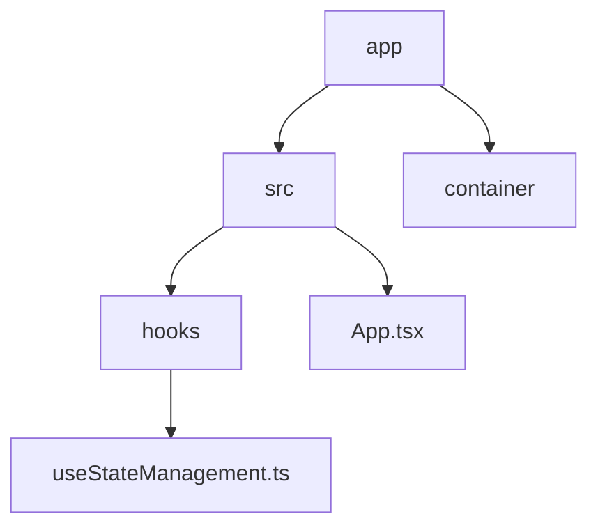

**Staff-Level Trade-offs and Corner Cases**

- **Where does file content live?** The speaker said the content can be attached to the explorer structure itself ("if this is the path, then this is the content"), or fetched by ID. **Staff addendum (not from the session):** storing content inline makes the tree document huge and every rename or move rewrite large payloads; splitting _metadata tree_ from _content blobs keyed by ID_ keeps tree operations cheap and lets you lazy-load file bodies.
- **Renames and moves** are tree edits with stable IDs, so references to a file survive a rename.
- The tree is a **virtual** filesystem; real files only exist when you execute (see [C5](#c5-problem-3-executing-code)).

---

## C4. Problem 2A Saving Code

**Core Concept and the Why**

Saving a folder is easy because there is no data attached. **Code has metadata**: keywords in different colors, **indentation** that must be preserved on the way back, newlines, comments. The user may use 5 spaces somewhere deliberately; when it comes back from the server it must render identically.

**Speaker's mental model (the key insight):** **"Start looking at code like a string."** Code you see in the editor is not executed as-is; a lot happens behind the scenes. Once you treat it as a string, the problem simplifies.

**Underlying Mechanics**

- Serialize code into a transport/storage format such as **JSON or XML**, preserving the metadata that matters.
- Represent line breaks explicitly (for example `\n`), and keep whitespace as written, so indentation survives the round trip.
- **Escaping:** what if the code itself contains a literal `\n`? You must escape the escape character. The speaker noted there is a standard sequence of ways to escape the escape characters, and you agree on one scheme.
- Either invent a **custom markup language** that client and server both understand, or reuse a standard (**markdown-like**) template for the metadata.
- Store it against the file's **path or ID** in the explorer structure.

```json
{
  "id": "125",
  "path": "app/src/App.tsx",
  "content": "function test() {\n     console.log('welcome');\n}\n// a comment here\n"
}
```

Round trip: the editor sends the string, the server persists it unchanged, and on load the same string is placed into the editor, which re-derives highlighting from the language **manifest** ([C2](#c2-problem-1-the-editor-itself)).

**Staff-Level Trade-offs and Corner Cases**

- **Colors need not be stored.** Since the manifest can recompute highlighting from the raw text, the genuinely lossy parts to protect are **whitespace, newlines, and escaping**. This is consistent with the speaker's "code is a string" model.
- **Staff addendum (not from the session):** using `JSON.stringify`/`JSON.parse` gives you correct escaping for free; also consider line-ending normalization (`\r\n` vs `\n`), file-size limits, and a version or revision number so concurrent saves can be detected.

---

## C5. Problem 3 Executing Code

**Core Concept and the Why**

Writing and saving code is not enough; the user must **see output**. Take a React project: the code lives as strings in a virtual tree; how does it become a running app? The speaker noted that it is _very similar to how your React projects run in production_: they need to be built and served.

**Approaches discussed (and the speaker's response to each)**

| Approach                                                                               | Proposed by                                 | Speaker's assessment                                                                                                                               |
| -------------------------------------------------------------------------------------- | ------------------------------------------- | -------------------------------------------------------------------------------------------------------------------------------------------------- |
| Parse `package.json` and run npm commands via a terminal like a local CRA/Vite project | Param                                       | Not enough on its own: `package.json` alone is not the project. You need the **full code context** (`App.tsx` through every file) to render output |
| Run a **Docker** image/container per project                                           | Krishna                                     | Pushed back on cost: if every change creates a new instance, you are continuously rebuilding and shipping new instances                            |
| **Server bundles, client executes the bundle**                                         | Shivam                                      | Partially right: the server does heavy processing, the client runs the result                                                                      |
| **Client bundles and executes in the browser**                                         | (speaker)                                   | Possible for a React-only product, but you would maintain a different flavor per framework                                                         |
| **Server-side project, incremental bundling, URL served into an iframe**               | (speaker, how CodeSandbox-style tools work) | The universal approach (below)                                                                                                                     |

**Underlying Mechanics: the server-side model the speaker described**

1. When you create a React project in the sandbox, an **actual project is created on the server**.
2. On each code change, modern bundlers (**Webpack, Vite, Turbopack**) do **incremental bundling**: only the changed portion is re-bundled, not everything.
3. The resulting bundle is deployed to a place with a **URL**, and the URL is sent to the client.
4. The preview pane on the right is an **iframe** loading that URL.
5. Every edit is sent to the server, which updates and rebuilds, and the iframe refreshes.

**Adding a library (for example Axios):** you are effectively **editing `package.json`** (a string/file update). But on the backend, a change to `package.json` means you can no longer do a cheap incremental bundle: you must **re-run `npm install` or `yarn install`**, then produce a new bundle and serve it. So adding a dependency is **slower** than a normal file change.

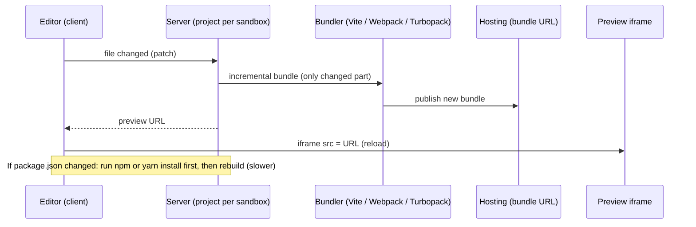

**Why the speaker prefers server-side execution:** the interim option (store code as JSON and bundle in the browser) works for React, but he does not want to maintain a different flavor per technology. The goal is a **universal structure** that serves **every** language and framework: React, JavaScript, Java, C#, Node. That works best when execution happens on the **backend**.

**Non-UI languages (Java example)**

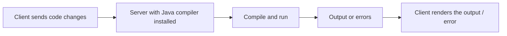

For Java there is no UI to render, only output. The code is sent to the backend, which has a compiler installed, runs it, and returns the output or errors; the client renders them. **Same as your laptop, except the editor and CPU are the server's.** (The client is a server-driven editor; the CPU that executes the code is on the server.)

**Staff-Level Trade-offs and Corner Cases**

| Dimension              | Server-side execution                                              | Client-side bundling              |
| ---------------------- | ------------------------------------------------------------------ | --------------------------------- |
| Language coverage      | Universal (any compiler or runtime)                                | Limited to what runs in a browser |
| Cost                   | You pay for CPU, memory, isolation                                 | Free compute (the user's machine) |
| Latency                | Network round trip plus build                                      | Local, very fast                  |
| Security               | Large attack surface ([C8](#c8-security-of-server-side-execution)) | Browser sandbox                   |
| Operational complexity | High (scheduling, quotas, cleanup)                                 | Low                               |

- **Speaker's decision rule:** if your product is a _single-framework_ tool, client-side bundling can be fine; if it is a **universal multi-language** IDE, execute on the server.
- **Cost control:** do not build a fresh instance per keystroke (the objection to Docker-per-change). Reuse a long-lived project and apply incremental changes.
- **Staff addendum (not from the session):** isolation (containers, resource limits), idle shutdown, and warm pools are what make server-side execution economical.

---

## C6. Problem 4 Editing and Syncing Efficiently

**Core Concept and the Why**

`App.tsx` has 35 lines and you add one `console.log("hello world")`. The server's copy must be updated. _"It is more depth than what you think."_

**The rudimentary approach and why it breaks:** every few seconds (say every 3 seconds) send the **entire file** to the backend. As the user types, request 1 contains `hello`, request 2 contains `hello` plus a space, request 3 contains `hello` plus two spaces, and every request carries the whole file. That is **too many calls with large payloads**, hard for the backend to absorb.

**Speaker's optimal approach: send a PATCH request describing only what changed.**

- REST verbs recap: GET, POST, PUT, **PATCH**, DELETE. **PATCH** means modifying a _part_ of a resource.
- The request says _where_ and _what_: for example "in file X, between line 8 and 10, add this `console.log`". The server edits just that portion instead of replacing the whole file. The backend keeps an equivalent line model of the file so line numbers map correctly.
- **Autosave** works by sporadically sending these changes to the backend.

```ts
// A small, targeted patch instead of the full 35-line file
PATCH /api/files/125
{
  "range": { "startLine": 8, "endLine": 10 },
  "text": "  console.log('hello world');\n"
}
```

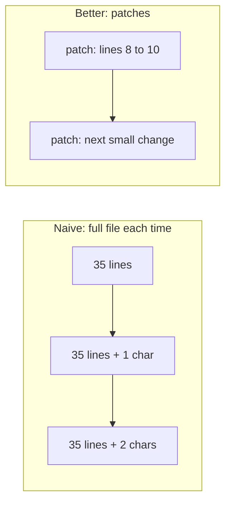

**Staff-Level Trade-offs and Corner Cases**

- **Payload size:** patches scale with the _change_, not the file.
- **Ordering and loss:** patches are only correct if applied in order against the right base; you need a revision number or ack so a dropped or reordered patch does not corrupt the file. (This echoes the ordering concern from [B6](#b6-race-conditions-and-out-of-order-responses).)
- **Concurrent editors:** two people patching the same lines at once is the **live collaboration** problem, which the speaker explicitly deferred to the Google Docs session.
- **Staff addendum (not from the session):** debounce autosave, batch multiple keystrokes into one patch, and fall back to a full-file sync on a version mismatch.

---

## C7. Editor Autocomplete Mechanics

**Core Concept and the Why**

> **Speaker's key correction: editor autocompletion is not an AI feature.** Typing `arr.` and getting suggestions for array methods is a **deterministic, finite-possibility** problem, not code generation.

**Underlying Mechanics**

- The editor looks at the **cursor position** and computes what the **possible next tokens** can be at that point. The set of possibilities is **finite**.
- **Built-in types** are the easy case: for `let arr = [1,2,3,4]`, typing `arr.` suggests the array prototype methods because the type is known.
- **Custom objects** are harder. For `const obj = { firstName, lastName }`, typing `obj.` must suggest `firstName` and `lastName`. That means the editor must **continuously track references** and keep updating them.
- **Depth:** an object with 10 levels of nesting means each level has its own reference chain that must be resolved and suggested.
- **Type-driven:** if `obj.firstName` is an **array**, then `obj.firstName.` should offer **array methods**. The suggestion depends on the _resolved type_ of the reference.
- Monaco-class editors already ship this capability. The speaker flagged "how does autocompletion actually work" as a deep, thought-provoking question worth reading more about and offered to explain it further if asked.

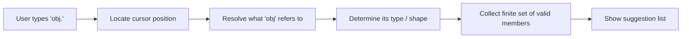

**Staff-Level Trade-offs and Corner Cases**

- A naive "keyword matching" approach (Sourav's question) works for language keywords but **not** for user-defined shapes; you need reference and type tracking, kept up to date as code changes.
- **Staff addendum (not from the session):** real editors do this with a language service that parses the code into an AST and runs incrementally; doing it in a worker keeps the UI thread free.

---

## C8. Security of Server Side Execution

**The question (Shivam):** _"How do we secure the server, since we execute user code on it?"_

**Speaker's answer**

- There are **multiple levels of attack**. Examples raised: running queries (SQL) to extract information about the system itself (which server it is on, credentials, anything saved there), **clickjacking**, and **code injection**.
- For **known attacks**, products like CodeSandbox already have protections and fallbacks (for example they will not execute a query that runs against their own system).
- **No system is completely secure.** There will be loopholes; as attacks are identified, they get fixed. He pointed to his separate session on common attacks and threat handling, and said CodeSandbox likely follows the same approach.

**Staff addendum (not from the session):** the standard defenses for running untrusted code are layered isolation (per-sandbox containers or microVMs), strict CPU, memory and time limits, **no outbound network by default**, read-only base filesystems, serving previews from a **separate origin** with the iframe `sandbox` attribute, and secret-free execution environments. Naming these shows Staff-level threat modeling.

---

## C9. Remaining Features and Deferred Topics

| Feature                              | What the speaker said                                                                                                                              |
| ------------------------------------ | -------------------------------------------------------------------------------------------------------------------------------------------------- |
| **Shareable link**                   | Mostly backend: whenever you spin up a project or create a new one, generate a **unique link pointing to that particular server instance/project** |
| **Public / private**                 | Backend-oriented visibility flag                                                                                                                   |
| **Errors and debugging**             | The project runs on the server; whatever the output or error is gets shown in the output/console                                                   |
| **Code download**                    | Relatively straightforward once code is saved as JSON or another structured format                                                                 |
| **Authentication and authorization** | Taken separately; not specific to this product                                                                                                     |
| **Offline support**                  | Will be discussed with Google Docs                                                                                                                 |
| **Concurrent editing**               | Will be discussed with Google Docs (two members editing the same document at the same time)                                                        |
| **Git integration, AI tools**        | Not discussed                                                                                                                                      |
| **Autosave**                         | Sporadic patches to the backend ([C6](#c6-problem-4-editing-and-syncing-efficiently))                                                              |

---

## C10. Part C Interview Drills

**Drill 1. "Design CodeSandbox."**
Decompose: (1) editor, (2) file explorer, (2A) save, (3) execute, (4) edit/sync. Buy Monaco or CodeMirror; JSON tree with IDs; code as a string with careful escaping; execute on the server with incremental bundling and an iframe preview; patch-based sync; defer collaboration and offline explicitly.

**Drill 2. "How do you store a folder hierarchy that does not physically exist?"**
Nested JSON with `id`, `name`, `isFolder`, `icon`, `children`; render recursively; use the ID to fetch file content.

**Drill 3. "Why is client-side bundling not enough?"**
It ties you to a single framework flavor. A universal IDE across React, JavaScript, Java, C# and Node needs a uniform server-side execution model.

**Drill 4. "What happens when a user adds Axios?"**
`package.json` changes, so incremental bundling is not enough: re-run the package manager install, rebuild the bundle, and re-serve. It is slower than a normal file edit.

**Drill 5. "Autosave is hammering the backend. Fix it."**
Stop sending the whole file; send **PATCH** requests with the changed line range, debounce them, and keep revision numbers to detect gaps.

**Drill 6. "Is editor autocomplete AI?"**
No. It is cursor-position-based, finite-possibility resolution using references and types (built-ins plus user-defined shapes), already provided by Monaco-class editors.

---

# Part D. The Interview Execution Playbook

These are the _meta_ lessons the speaker repeated across the three topics. Interviewers grade the **process** as much as the answer.

## D1. A repeatable structure

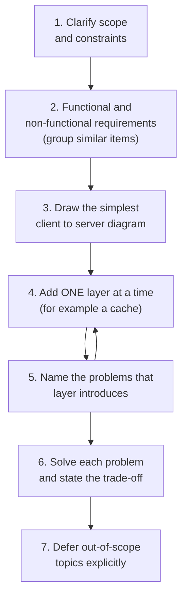

## D2. Principles to state out loud

| Principle                                                | Where it showed up                             | The "why"                                                                                                 |
| -------------------------------------------------------- | ---------------------------------------------- | --------------------------------------------------------------------------------------------------------- |
| **Narrate your technique** ("this is how I approach it") | Every diagram                                  | Interviewers cannot read your mind; the process is graded                                                 |
| **Start from the extreme basics**                        | Typeahead baseline                             | Gives the interviewer a shared starting point and makes each added layer justifiable                      |
| **Every optimization has a cost**                        | Caching, aborting, session replay, memoization | Reflexive optimization is a junior signal; trade-off reasoning is the senior one                          |
| **Do not reinvent the wheel**                            | Monaco / CodeMirror                            | Build-vs-buy judgment; still explain how you _would_ build it if forced                                   |
| **Decompose a large product into numbered problems**     | Code Sandbox 1, 2, 2A, 3, 4                    | Prevents boiling the ocean                                                                                |
| **Treat data as the simplest type** ("code is a string") | Saving code                                    | Complexity usually collapses once you pick the right abstraction                                          |
| **Define success criteria for every feature**            | Search feature target of 10,000 users          | Ties engineering to measurable outcomes                                                                   |
| **Backend is not the whole truth**                       | Client-side alerting and latency               | The user's experience includes the network you do not own                                                 |
| **Scope the API question by problem size**               | Autocomplete vs Code Sandbox                   | Small components may be asked for an API contract; big products cannot be fully specified in an interview |

## D3. Diagramming craft

- Practice drawing diagrams **quickly**; use a mouse if you can, because trackpad-only editing is slow.
- **Do not add grouping or background layers** until the design is final; in canvas tools they sit on top and make editing the inner shapes painful.
- Keep names consistent between diagram and narration (Client, Cache, Backend, Search key, Search results).

## D4. The mindset takeaway

> _"Start looking at every frontend system like a developer, not a consumer."_ When you watch a video on Prime or Netflix, ask how it was built. The folder-structure-as-JSON idea looks obvious once explained, but nobody invents it the first time; **repeated observation** is what makes these solutions occur to you on their own.

**Related material referenced as upcoming or companion topics:** news feed (image optimization), Google Docs (offline support and concurrent editing), authentication and authorization, and threat handling (common attacks and mitigations).

---

# Part E. Rapid Fire Questions and Answers

**Q1. What is the difference between monitoring and observability, and should you separate them in an interview?**
Monitoring tells you _something is wrong_; observability tells you _why_. The speaker's advice: do not over-separate. Frame both as "how do I detect a production problem and how do I fix it".

**Q2. Why do you need frontend monitoring when the backend is already monitored?**
Many failures never reach the backend (poor network, device or browser issues), and the user's latency includes layers (Wi-Fi/mobile, ISP, proxies) that the backend cannot see.

**Q3. What should every error report contain?**
Message, stack trace, component/page, browser and OS, session and network state, user ID, route, feature flags and release version, attached automatically through one common logging function.

**Q4. Synthetic monitoring vs RUM?**
Synthetic: simulated tests (Lighthouse CLI, device farms like BrowserStack and Sauce Labs); proactive but costly and incomplete. RUM: real users' data (web-vitals, Google reports, Google Analytics); the ground truth, which the speaker called critical.

**Q5. How can orders drop with zero errors?**
A behavioral/UX regression, for example the Place Order button moved to the top of a mobile screen. Version-tagged funnel analytics reveal which release and which step.

**Q6. Why is a feature's success metric defined before building it?**
Because the API call count does not measure discoverability. Set a target (for example 10,000 of 1,000,000 users in a week) and alert if missed.

**Q7. What is a correlation ID?**
A unique ID per request passed through every system it touches, so you can trace where a request got to and where it failed.

**Q8. When should you use session replay?**
Sparingly, on critical revenue flows. It has an ongoing capture and processing cost and privacy implications.

**Q9. How do you pick an alert threshold?**
Observe real behavior over weeks to months to learn the steady-state baseline, then choose a tolerance (percentage or absolute number). You cannot do it on launch day.

**Q10. What makes a good alert?**
Actionable, severity-classified (P0 to P3), and routed to the right team and channel (call for critical, Slack/Teams for non-critical).

**Q11. What do PagerDuty and xMatters do?**
They deliver alerts (phone, email, Slack, Teams). Deciding _when_ to alert is your logic.

**Q12. Why must the frontend team also be alerted if the backend error rate is under control?**
Because extra client-observed failures can be client-side (for example regional connectivity loss) and are invisible to the backend.

**Q13. In autocomplete, what is the first architecture improvement over client to backend?**
A client-side cache layer in front of the backend: check cache, return on hit, otherwise call backend and store.

**Q14. What is wrong with a naive key-to-results cache?**
Duplicated results across keys, memory growth, and staleness if cached forever.

**Q15. How do you expire the autocomplete cache?**
Global TTL, per-entry timestamps and TTLs, clear on session boundary, and invalidate when the same key is searched twice. The choice depends on how often the data changes.

**Q16. What is a normalized cache?**
Store each distinct result once (by ID) and map queries to IDs, removing duplication.

**Q17. How do you prevent stale suggestions from slow responses?**
Tag each request, cache every response, and render only the response of the latest request. Abort is a byproduct, not the design, since there is no true abort once the request is sent.

**Q18. Why does comparing the response query to the current input fall short?**
The user may have typed more by the time a response arrives, so strict equality can reject everything and show nothing.

**Q19. Build or buy a code editor?**
Buy (Monaco or CodeMirror). Building means re-implementing highlighting, indentation, validation and autocomplete per language. If forced to build, use a per-language manifest and a render engine.

**Q20. How do you store a nonexistent folder tree?**
Nested JSON with `id`, `name`, `isFolder`, `icon` and `children`; render recursively; use `id` to load content.

**Q21. How do you save code without losing indentation?**
Treat code as a string; preserve whitespace and newlines; handle escape characters; store under the file ID or path.

**Q22. How is user code executed in an online editor?**
Preferred universal model: a real project on the server with incremental bundling, served via a URL into an iframe for UI frameworks; for non-UI languages, compile and run on the server and return output or errors.

**Q23. Why is adding a dependency slower than editing a file?**
`package.json` changes force an `npm`/`yarn install` and a rebuild, not just an incremental bundle.

**Q24. How do you sync edits efficiently?**
Send PATCH requests with the changed line range instead of the full file on every change.

**Q25. Is code autocompletion AI?**
No. It resolves a finite set of valid completions from the cursor position, references and types.

---

# Part F. Cheat Sheet and Elevator Pitches

## F1. One-page cheat sheet

| Topic                 | Key facts to recall                                                                                                                                                                                                                                                |
| --------------------- | ------------------------------------------------------------------------------------------------------------------------------------------------------------------------------------------------------------------------------------------------------------------ |
| Observability signals | Errors, performance, behavior, logging, session replay; alerting on top                                                                                                                                                                                            |
| Error context         | message, stack, component, browser/OS, session/network, user ID, route, flags, version, via one common function                                                                                                                                                    |
| Tools named           | Sentry, Bugsnag, Rollbar (errors); Lighthouse CLI, BrowserStack, Sauce Labs (synthetic); web-vitals, Google Analytics (RUM); Mixpanel, Amplitude (behavior); LogRocket, FullStory (replay); PagerDuty, xMatters (alert delivery); Grafana (common backend logging) |
| Client vs backend     | Client sees network failures and true end-to-end latency; backend cannot                                                                                                                                                                                           |
| Alert thresholds      | Derived from weeks to months of baseline; percentage or absolute; actionable; P0 to P3; routed                                                                                                                                                                     |
| Funnel                | Search, details, buy, address, pay; measure drop between steps; version-tag events                                                                                                                                                                                 |
| Autocomplete pipeline | min chars, debounce, cache, backend, latest-request guard                                                                                                                                                                                                          |
| Cache expiry          | global TTL, per-entry TTL, session boundary, repeat-search invalidation                                                                                                                                                                                            |
| Race condition fix    | Stamp requests; cache all; render only the latest; abort is optional                                                                                                                                                                                               |
| Code Sandbox problems | 1 editor, 2 file tree, 2A save, 3 execute, 4 sync                                                                                                                                                                                                                  |
| Editor                | Monaco or CodeMirror; manifest per language if built from scratch                                                                                                                                                                                                  |
| File tree             | Nested JSON with ids, isFolder, icon, children                                                                                                                                                                                                                     |
| Saving                | Code is a string; preserve whitespace; escape carefully                                                                                                                                                                                                            |
| Execution             | Server project, incremental bundling, URL in iframe; install on dependency change; server compile for non-UI languages                                                                                                                                             |
| Sync                  | PATCH with line ranges                                                                                                                                                                                                                                             |
| Autocomplete (editor) | Not AI; cursor plus references plus types                                                                                                                                                                                                                          |
| Security              | Layered; known attacks have fallbacks; no system is fully secure                                                                                                                                                                                                   |

## F2. Elevator pitches (say these out loud)

- _"Frontend observability exists because I cannot reproduce every device, browser and network combination. I monitor errors, performance, and user behavior, trace requests with correlation IDs, and alert on thresholds that I derived from real baselines, so the right person is paged with an actionable alert."_
- _"A healthy backend does not mean healthy users. Client-side monitoring is the only thing that sees network failures and true end-to-end latency, so the frontend needs its own alerts."_
- _"For every feature I define a success criterion before building it. API counts do not tell me whether users can discover it, so I track the entry point and set an alert if adoption misses the target."_
- _"For typeahead I start with client to backend, add min characters and debounce, add a client cache, then deal with its problems: duplicates, memory, staleness, and the real killer, out-of-order responses, which I solve by caching every response but rendering only the latest request."_
- _"There is no true abort once a request is on the wire; I can only ignore the response, so I make correctness depend on a latest-request guard, and treat abort as an optimization."_
- _"For an online editor I decompose the product: use Monaco or CodeMirror instead of building an editor, store the file tree as nested JSON with IDs, treat code as a string, execute on the server with incremental bundling into an iframe, and sync with line-range patches instead of full files."_
- _"Editor autocomplete is not AI. It is a deterministic resolution of valid completions from cursor position, references and types."_

## F3. Self-check list before the interview

- [ ] Can I explain monitoring vs observability in one sentence without over-splitting them?
- [ ] Can I tell the Place Order button story and what it teaches about versioned behavior analytics?
- [ ] Can I justify a threshold using a baseline, and say why the client needs its own alerts?
- [ ] Can I draw the typeahead diagram incrementally and name each added layer's problem?
- [ ] Can I explain why abort is not a true cancel, and what I do instead?
- [ ] Can I decompose Code Sandbox into numbered problems and defend build-vs-buy?
- [ ] Can I describe how a React project actually runs inside a sandbox and why adding a library is slower?
- [ ] Can I say what I deferred (collaboration, offline, Git, AI) and why?

---

_End of guide._
