<a id="top"></a>

# Frontend System Design: Study Guide (Week 6)

**Source:** Recorded session (Vasanth, Career With Vasanth) on system design fundamentals.
**Style:** Simple English, same flow as the speaker. Each topic has a **WHY** so you can explain it in an interview.

> **How to use this guide**
> - Click any link in the Table of Contents to jump to that part. Every section has a **Back to top** link.
> - **Speaker said:** what was taught in the session.
> - **Extra (Staff level):** small additions a senior interviewer may ask. These are not from the session.
> - **WHY:** the reason behind the idea. Interviewers hire for reasons, not for definitions.

---

## Table of Contents

| # | Section | Sub-parts |
|---|---|---|
| 1 | [Types of System Design Interviews](#s1) | [1.1 Three types](#s1_1) · [1.2 HLD vs LLD](#s1_2) · [1.3 Pseudocode](#s1_3) · [1.4 Which type at which experience](#s1_4) · [1.5 Two golden rules](#s1_5) |
| 2 | [Frontend Architecture: Monolithic vs Micro Frontend](#s2) | [2.1 Why architecture](#s2_1) · [2.2 Monolithic](#s2_2) · [2.3 Micro Frontend](#s2_3) · [2.4 Pros and cons](#s2_4) · [2.5 Talking between MFEs](#s2_5) · [2.6 Auth in MFE](#s2_6) · [2.7 How to divide](#s2_7) · [2.8 When to use](#s2_8) · [2.9 Module Federation](#s2_9) |
| 3 | [Monorepo vs Polyrepo](#s3) | [3.1 Definitions](#s3_1) · [3.2 Not the same as architecture](#s3_2) · [3.3 How polyrepo still ships one app](#s3_3) · [3.4 Growth path](#s3_4) · [3.5 Comparison table](#s3_5) · [3.6 No right or wrong](#s3_6) |
| 4 | [Rendering Patterns](#s4) | [4.1 CSR](#s4_1) · [4.2 SSR](#s4_2) · [4.3 SEO and bots](#s4_3) · [4.4 SSG](#s4_4) · [4.5 ISR](#s4_5) · [4.6 Comparison](#s4_6) · [4.7 Mixing patterns](#s4_7) · [4.8 Open question: why no page reload](#s4_8) |
| 5 | [Authentication vs Authorization](#s5) | [5.1 Difference](#s5_1) · [5.2 RBAC](#s5_2) · [5.3 ABAC](#s5_3) · [5.4 Feature level](#s5_4) · [5.5 Together](#s5_5) · [5.6 Design rules](#s5_6) · [5.7 Direct URL problem](#s5_7) |
| 6 | [Feature Flags](#s6) | [6.1 What and why](#s6_1) · [6.2 Types](#s6_2) · [6.3 How it works](#s6_3) · [6.4 Design concepts](#s6_4) · [6.5 Big company rule](#s6_5) |
| 7 | [Scenario 1: Flag changes while user is using the feature](#s7) | |
| 8 | [Scenario 2: Logout from one tab](#s8) | |
| 9 | [Homework Scenarios](#s9) | [9.1 Upgrade during a transaction](#s9_1) · [9.2 Frequent URL changes](#s9_2) |
| 10 | [Axios vs Fetch](#s10) | |
| 11 | [Cheat Sheet](#s11) | |
| 12 | [Rapid-Fire Q&A](#s12) | |
| 13 | [Coverage Checklist](#s13) | |

---

<a id="s1"></a>

## 1. Types of System Design Interviews

*Context from the speaker:* we are in week 6. The next two weeks are mostly system design. Resume reviews and applying for jobs also start now. Before going deep, first understand **how system design is asked in interviews**.

<a id="s1_1"></a>

### 1.1 The three types

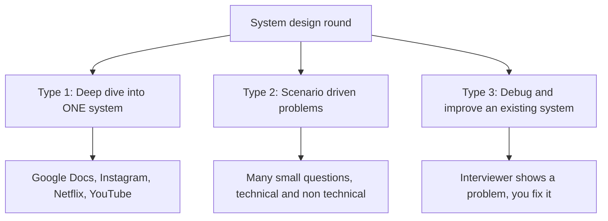

| | Type 1: Deep dive | Type 2: Scenario driven | Type 3: Debug existing system |
|---|---|---|---|
| What happens | One system for the full hour (Google Docs, Instagram, Netflix, YouTube) | A series of different questions to see your experience | Interviewer already knows the problem and asks how you will fix it |
| What you do | List functional + non functional requirements, architecture, trade offs, scaling | Answer each question with your thinking | Give step by step fixes |
| Interviewer style | May not have fixed requirements. Questions grow as you answer ("how will you cache?", "how will you make API calls efficient?") | Very specific questions | Shows a slow site or a messy codebase |
| Common in | Premium companies like Adobe, Microsoft | Mid tier companies like Razorpay, Apollo.io | Any company |
| Fits | 10+ years experience, 1 or 2 premium companies | 5 to 8 years | 5 to 8 years |

**Type 2 examples from the speaker:**
- *Release branching:* three teams work in parallel on Release 1, 2, 3. Release 2 must have Release 1 changes, Release 3 must have Release 2 changes. Hot fixes keep coming. What is your team and GitHub branching plan?
- *Gmail-like draft:* user types a draft. How do you save it, show it on other devices (mobile too), save metadata, and handle an uploaded image?
- Also: choose React vs Vue vs Angular for the team. This tests decision making. Technical and non technical scenarios both come.

**Type 3 examples from the speaker:** app renders too often, bundle size is too big, app layer is messy, state management is broken, or "this website takes 5 seconds to load, what are your step by step actions?"

**WHY the interviewer asks Type 2 and 3:** to see if you have really handled such problems. If they hire you as staff or lead, you must solve these quickly.

> **Speaker note:** Type 2 and Type 3 are quite similar. The difference is that in Type 3 the problem is already visible in a running system.

<a id="s1_2"></a>

### 1.2 HLD vs LLD in frontend

- In frontend there is **no separate LLD round** like in backend.
- The **machine coding round** is your LLD round. You get a problem and start coding.
- Everything discussed in system design rounds is **High Level Design (HLD)**: you draw diagrams and explain your thinking. After that they may ask for pseudocode, or in a long interview (about 1.5 hours) a small working version with edge cases handled.

**Real example (speaker, Microsoft interview):** the question was a **type ahead system** (like Google search suggestions).
- First 40 to 45 minutes: discuss the problems of the system and how to solve them.
- Next 15 to 20 minutes: write pseudocode. "This function is responsible for this."

<a id="s1_3"></a>

### 1.3 What is pseudocode?

Code that need not compile. No need to worry about syntax errors. It just shows **how you will structure the flow**. It is more than explaining in words, because you must also write some real looking code.

```js
// Type ahead pseudocode (example from the session idea)
function onChangeText(text) {
  // 1. debounce so we do not call API on every key
  // 2. check cache first. If found, show it
  // 3. else call API, save result in cache, show result
}
```

<a id="s1_4"></a>

### 1.4 Which type is asked at which experience?

Question from a student (6.5 years): which type is asked most?
- Until two years ago system design was not important in good companies. It was asked for level 4 and above.
- **Now it is asked even after 5 years**, because coding is slowly moving to Gen AI, so system design became a better way to measure engineers.
- For about 6.5 years: **Type 2 or Type 3** will come more often.
- **Type 1** (deep dive on one big system) is mostly for **10+ years** in premium companies. Even then they may check Type 2 and 3.

<a id="s1_5"></a>

### 1.5 Two golden rules for the interview

1. **Do not try to predict how the real company built it.**
   - Example: Notion has a nice editor where you copy and paste, make H1 and H2, and right click options are Notion's own. Do not say "Notion does it like this." Unless they open sourced it or wrote an article, you do not know.
   - Answer as: **"If I had to build it, this is how I will do it."**
   - If you truly know how they did it, you can say it. But do not just copy and guess. Many candidates lose points saying "YouTube might have done this".

2. **Do not argue. Be open to change your answer.**
   - Discussion and argument have a thin line between them.
   - If you say approach A and the interviewer says approach B, **check the merits of B first**. Pick it if it is better.
   - The interviewer is often not setting a trap. They may really want to discuss and reach a solution.
   - **WHY:** this is exactly how it works in a real company. People change your proposal a little, you accept it and move forward.

**Also (from summary):** when you give a solution, the interviewer may counter it. You should be able to counter back, or change the answer, so the interviewer understands your thinking.

[⬆ Back to top](#top)

---

<a id="s2"></a>

## 2. Frontend Architecture: Monolithic vs Micro Frontend

<a id="s2_1"></a>

### 2.1 Why does frontend architecture matter?

Good apps keep growing: more features, more teams, faster releases, independent deployment, different technologies. Without a proper architecture the project becomes:
- tightly coupled
- hard to scale
- slow to deploy
- difficult to maintain

Frontend architecture decides **how code is built, owned and deployed at scale**. There are two main ways: **Monolithic** and **Micro Frontend**.

<a id="s2_2"></a>

### 2.2 Monolithic

**Definition:** A single frontend application with all features, pages and UI modules in **one codebase and one build**. Everything is shipped together.

**Example (Amazon, if you start today):** you have a small team, so you keep Home, Search, Product Details, Cart in one GitHub repo. At build time everything becomes one bundle and goes to the user. Small example: an app with only 3 pages (dashboard, order, profile), all part of the same project.

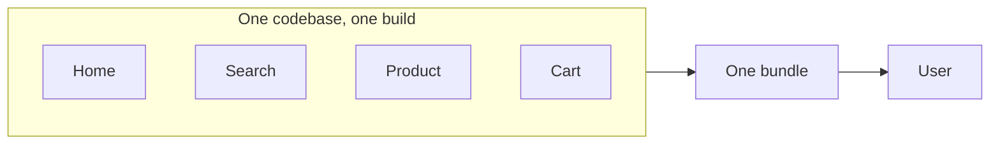

**Advantages**
- Simple to start. Everything is at one place.
- Easy dependency management. Example: Axios version updates at one place and every module gets it. Teams often need to do nothing.
- Shared state is easy (same project).
- Fast local development. Everyone has access to every module.
- No cross team or cross app communication needed.

**Problems at scale**
- Large bundle size, slow builds.
- Teams **block each other**. Example: Home team has not finished their change. Product, Cart, Checkout, Orders are ready but **nobody can release** because it is a single bundle.
- Risky deployments (one change affects everything).
- Hard to use different tech stacks. If a part is built in Angular, you cannot reuse it in React.
- Code ownership becomes unclear.
- Platform teams and component teams build things and others must wait for them.

**Best for:** small to medium apps, single team, early stage product, tight feature coupling.

> **Speaker note:** This does **not** mean big companies cannot use monolithic. He said Google and GitHub still use monolithic. Most good companies **start** monolithic and slowly evolve. Example: his own site (CareerWithVasanth) is a single page app today because the plan for the future is not clear. One project gives freedom.
>
> **Extra (Staff level):** Google is the famous example of a **monorepo** (one repository). That is about code storage, not about how the app is shipped. This mix up is exactly what Section 3 clears.

<a id="s2_3"></a>

### 2.3 Micro Frontend (MFE)

**Definition:** The frontend is split into **many independent applications**. Each is **owned by a different team** and **deployed separately**.

**Amazon example:** Home team, Search team, Product team, Cart team, Checkout team, Profile team. Each is its own React app, own GitHub repo, built separately, deployed separately. (Example: Home on port 100, Search on port 101.)

**Paytm example (best one from the speaker):**
- Paytm app can do mobile recharge, gas cylinder booking, electricity bill, and (if active) Paytm Mall.
- The main Paytm app is **one container (core app)**.
- Electricity bill is handled by the electricity bill team. Gas booking by another team. Mobile recharge by another.
- The container just shows a **tile or button**. On click, it goes to that module's URL and **loads that component at runtime** (for example with `React.lazy`).
- If you never use electricity bill, that module may not even be downloaded for you.

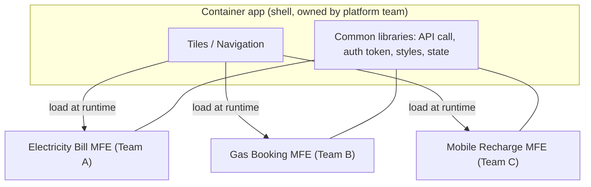

**Important point from the speaker:** "download only when needed" is **not** the real advantage of MFE. Lazy loading and bundle splitting can do that too. MFE is truly good when:

1. **The same block of UI is used in many apps.**
   - Example: Settings page. The Paytm user app has settings. The Admin app also has settings. Basic settings (name change, email change) are the same. Build **one settings app**, deploy it once, and load it lazily in both. No code duplication. If settings change tomorrow, the deployed instance updates everywhere.
2. **The team is spread across geographies** (India, Europe, USA, Australia). It is very hard to work as one team, so each team gets autonomy to build and then plug into the container.

Also possible: you split now, because you may use modules across other places in future.

<a id="s2_4"></a>

### 2.4 Pros and cons of Micro Frontend

| Advantages | Challenges |
|---|---|
| Independent team ownership (one big team becomes about 6 small teams) | Shared data is complex |
| Independent deployments | Cross app communication |
| Smaller codebases | Need one central team to manage everyone and solve problems |
| Technology flexibility | Version compatibility (Home 1.0 works only with Search 2.0, and Search team is not ready) |
| Faster scaling of the organization | Performance overhead |
| | **Operational complexity** (speaker: the biggest challenge in companies he worked in) |

**Why operations hurt:** one team becomes 5 or 6 teams, sometimes in different countries. One team can change something and not tell the others, knowingly or by mistake, and it breaks the whole release. It starts as a good idea and slowly becomes chaos at scale.

**Monolithic vs MFE in one line:** Monolithic = whole project is one unit for development and deployment. MFE = broken into many pieces, joined in a container, and pieces can be downloaded on click.

**Student question (Vaishali):** "In my company all features (user management, clustering, organization management) are in one UI repo. Backend has separate repos. What is this?"
- Speaker: UI is **monolithic**. Backend is **microservices**. You cannot name the whole system with one word, because frontend and backend are two different things.
- If all features are in one repo and ship together with no independent deployment, it is monolithic.

<a id="s2_5"></a>

### 2.5 How do MFEs talk to each other and share state?

**Student question (Muthu Raj):** Cart, Checkout, Orders are in different repos. How do they share state? I used web events. Is there a better way?

**Speaker's answer:**
- To run MFE at scale, you need a **platform team** (or at least one person who owns this). They take care of everything shared.
- Example: when the Order app is added at runtime and wants to call an API, it needs a **valid token**. If each MFE makes its own token logic, it will break (token expiry, refresh). So the platform team gives **one common HTTP library**. Container and Order app both use "HTTP library v1".
- Anything that must change (library 1.0 to 2.0) must be **informed to all 6 teams** and all must update. Sometimes backward compatibility helps, sometimes the update is mandatory.
- If you are short of people and want MFE, **one of you must take the platform job**. Otherwise at production and scale you will fail.
- For **state**: use a **central state library like Redux**. The platform keeps common things (user name, user info) in it. Each team takes a **slice**.
- For team to team contracts: Home team says "I will dispatch this Redux event." Checkout team says "I will listen to it." For navigation, Home team passes agreed params to Checkout.
- Do not think of MFEs as teams that never talk. They talk a lot. Even in monolithic, people must talk.
- Do not just save cart to backend and read it again in Checkout. When you add to cart, the cart icon must update right away (state change) **and** the API call happens.

> **Extra (Staff level):** Other common ways to talk between MFEs: browser custom events, shared event bus in the container, props passed by the container, URL params. Keep the shared state **small**. The more you share, the more you are tied together, and then you lose the point of MFE.

**Question: how do teams coordinate?** (Anand) Any formal way works: a common meeting of team leads, a central team that owns the roadmap, and direct talks when two teams need a change.

<a id="s2_6"></a>

### 2.6 Authentication in MFE

**Question (Param):** Does the shell set cookies and all MFEs use it? What about amazon.com shell and checkout.amazon.com?

**Speaker's answer:**
- Authentication is a **capability of the container (core app)**.
- Other apps load at runtime, so the token is already set.
- There is a central library for API calls. Everyone uses it. The library reads the cookie, makes the call, and handles changes (like token refresh).
- Sharing token across sub domains is **your architecture choice**. Example: google.com and youtube.com share a common login.
- The core / container team must expose all these common things as APIs to other teams.

<a id="s2_7"></a>

### 2.7 How to divide an app into MFEs?

- Best to divide by **features**, and it depends on the app type.
- Paytm style app is easy: recharge is one, cylinder booking is one, electricity is one.
- Anything that is a platform capability goes to the platform.

<a id="s2_8"></a>

### 2.8 When should you use Micro Frontend?

**Student concern (Muthu Raj):** MFE is hard to set up, needs a big team, and a new developer finds it hard.
**Speaker agrees:** MFE is logically hard to handle.

- **Do NOT make MFE your default.** **Monolithic should be the default.**
- If Google and GitHub can run a monolithic app, yours can too. (He also mentioned Amazon Prime moving to monolithic, in the backend.)
- Use MFE only for the **two reasons** in 2.3: shared UI blocks used in different places, and teams spread across the world.
- MFE has **technical cost, communication cost and management cost** (you may even need a program manager).
- Career note from the speaker: for a tech lead or staff role, **communication is a key skill**, even before technical skill. If you cannot communicate you cannot defend your team or answer in RCA calls.

> **Extra (Staff level), one line to say in interview:** "I start monolithic. I move to MFE only when team size or reuse forces me, because MFE adds communication and operations cost."

<a id="s2_9"></a>

### 2.9 Module Federation (answer to Ramya's question)

In simple words: **loading a JavaScript module at runtime, in a lazy way, from somewhere else.**
- You divide your app into modules.
- Required modules are loaded at runtime on demand.
- Example: the Order app is served from a totally different URL (an independent deployed instance), and the container loads it at runtime. That is module federation.

> **Extra (Staff level):** In real projects this is the **Webpack Module Federation** feature (also available in Vite plugins). One thing to watch: shared libraries (like React) must be shared, or the user downloads two copies and hooks may break.

[⬆ Back to top](#top)

---

<a id="s3"></a>

## 3. Monorepo vs Polyrepo

<a id="s3_1"></a>

### 3.1 Definitions

These describe **how code is stored**, not how the app is built.

| | **Monorepo** | **Polyrepo** |
|---|---|---|
| Meaning | Many logical projects in **one** Git repository (home, search, cart, checkout, profile all in one repo) | Each application or service in **its own** Git repository |
| Good | Easy code sharing, one source of truth, simple dependency management, easy refactor across projects, same tools and coding rules | Full team independence, smaller repos, independent deployment and release, easier access control |
| Bad | Repo becomes large over time. Build and CI/CD get slow without proper tools (a small change may run all lint and unit tests). Needs tools like **Nx** or **Turborepo** | Sharing common code is harder. Library update must be done in every repo (raise PR, review, merge, repeat for 10 repos). Keeping consistency needs more coordination |
| Best for | Closely related projects | Highly independent teams |

> **Speaker note:** words like "harder code sharing" are logical, but you cannot measure them. If teams are well organized, sharing may not be hard. In an interview, **back your point with an example that happened to you.**

<a id="s3_2"></a>

### 3.2 Monorepo/Polyrepo is NOT the same as Monolithic/Micro Frontend

This is the confusion the speaker wanted to clear. Listen to this part carefully.

| | Monolithic / Micro Frontend | Monorepo / Polyrepo |
|---|---|---|
| Describes | **Application architecture** | **Source code organization** |
| Focus | **Runtime and deployment**: how the app is built and shipped | **Development and version control**: where code is stored |
| Question it answers | How is it delivered to the user? | Where is the code kept? |

You can mix them in any way:

| | Monorepo | Polyrepo |
|---|---|---|
| **Monolithic** | Yes (default start) | Yes (see 3.3) |
| **Micro Frontend** | Possible, but not suggested | Usual way |

<a id="s3_3"></a>

### 3.3 How can a polyrepo still be monolithic?

**Student question (Muthu Raj):** "If the repos are different, how are they bundled together?"

**Answer:**
- Home, Search, Cart, Checkout are separate repos. Each team **publishes a version** (Home 1.0, Cart 3.0).
- The container app lists these versions in its **package.json**.
- When you run `npm install`, it goes to each repo, takes that version, and puts it into `node_modules`.
- If Cart finds a bug and publishes **3.1**, you update package.json and install again.
- At **build time** everything becomes **one bundle** and goes to the user.
- From the user side, nothing is downloaded at runtime. **So it is monolithic.** It has many repos, but it ships as one app.

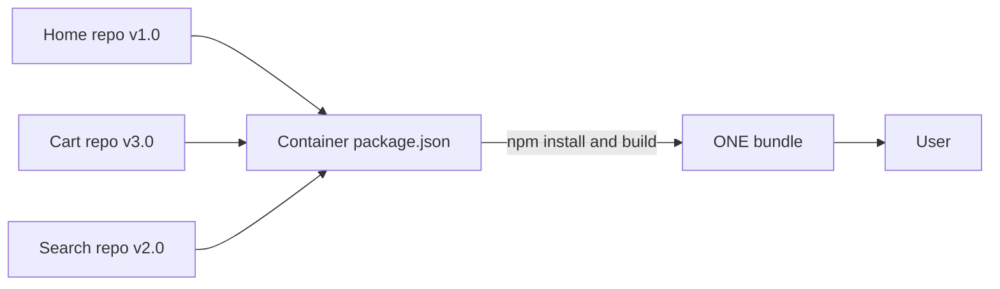

**Rule:** if it reaches the user as one app, it is monolithic, no matter how many repos.

**Student question (Param):** "In a monorepo, will the shared library also be in the same repo?"
Answer: No hard rule. You can keep libraries in the same repo, or keep them in a separate repo and use them by version. Or put everything in one repo. It depends on your use case.

**Another monorepo meaning:** a monorepo can also be a *logical group*. Example: for an e-commerce app, everything **before checkout** in one repo and everything **after checkout** in another repo. Each is a monorepo for its own group.

<a id="s3_4"></a>

### 3.4 Ideal growth path (what you should say in the interview)

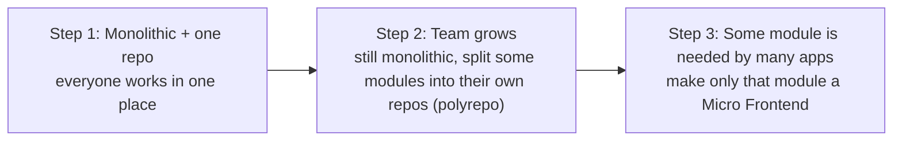

- Example for Step 2: the Cart team became too big. Make a separate Cart repo, move the team, they give you a version, you pull it in package.json. Same for Checkout and Product later.
- Example for Step 3: Settings page used across different verticals. Make only that one an MFE.
- **Student example (Vaishali):** company has one UI repo and now wants a separate repo for a React component library to share with other teams. Architecture is still monolithic. Repo style moves from single repo to polyrepo.
- **Do not use MFE just because you want to use MFE.** Start small. Moving to a new architecture later is easier today with GenAI help.

<a id="s3_5"></a>

### 3.5 Comparison table (from the slide)

| Point | Monorepo | Polyrepo |
|---|---|---|
| Git repositories | Single | Multiple |
| Code sharing | Easier | Harder |
| Dependency management | Centralized | Independent |
| Changes across projects | Easier | More complex across repos |
| Best for | Closely related projects | Highly independent teams |

<a id="s3_6"></a>

### 3.6 In system design there is no right or wrong

- System design is a **choice**. The choice is good if it fits **that use case and that company**.
- **Stack Overflow example (speaker):** they use a monolithic architecture and even on the backend they do not use microservices. Everything is in one place. He said they run with a very big amount of RAM (he mentioned about 3 TB) which is expensive, but it lets them process requests quickly, and the cost works for them. An experienced engineer may say "split it into many systems," but this has worked for them.
- So never say "this is wrong." Say "this fits when ..., and here is the cost."
- Monorepo vs polyrepo is rarely asked as a question because it is easy. The mix up with monolithic is what people get wrong, so be ready for that.

[⬆ Back to top](#top)

---

<a id="s4"></a>

## 4. Rendering Patterns

Four patterns are asked a lot in interviews: **CSR, SSR, SSG, ISR**.

<a id="s4_1"></a>

### 4.1 Client Side Rendering (CSR)

**How it works:** browser downloads a **minimum HTML file and a JavaScript bundle**. JavaScript runs in the browser and **builds the UI**.

- Example: plain React (Create React App). Login page, registration page, home page, settings page all come as **one bundle**. Then React makes each screen when the user needs it.
- Steps: browser gets HTML → downloads JS bundle → JS fetches data → UI renders in browser.
- Used by: Gmail, Trello, admin dashboards.

**Good for:** highly interactive apps, logged in dashboards, apps where **SEO is not important**, frequent UI updates. (Everything is already at the client, so interaction is easier.)
**Not good for:** SEO heavy sites, and the first load is slow on weak devices because the full bundle must come first.

<a id="s4_2"></a>

### 4.2 Server Side Rendering (SSR)

**How it works:** HTML is made **on the server for every request** and sent fully ready to the browser.

1. User asks for a page.
2. Server gets the data.
3. Server makes the HTML.
4. Browser shows the ready page.
5. JavaScript **hydrates** the page to make buttons, animations and state work. (Hydration will come in a later session.)

- The page is not part of a ready made bundle. It is formed on request.
- Example: **Next.js**.
- Common for: e-commerce product pages, news sites.

**Good for:** SEO heavy apps, **faster first content**, dynamic data on each request, **social media preview** (when you share a link, title and details are already there because the URL page already exists on the server).
**Not good for:** very high traffic with heavy rendering cost (server does a lot of work), static content (waste), and pages with a lot of UI interaction (every next page comes from the server, so there can be a small delay).

**Speaker's own example:** his first website was plain vanilla JS. Now he moved to **Next.js** because he wants the site to be found when someone searches "frontend interview preparation kit" or company interview experiences. He is customer facing, so being easy to find matters.

<a id="s4_3"></a>

### 4.3 SEO, and why SSR is friendlier to bots

**SEO = Search Engine Optimization.** When someone searches on Google, Google decides which links to show. Paid (sponsored) results come on top. Google uses **SEO bots** that visit your page to understand what it is about.

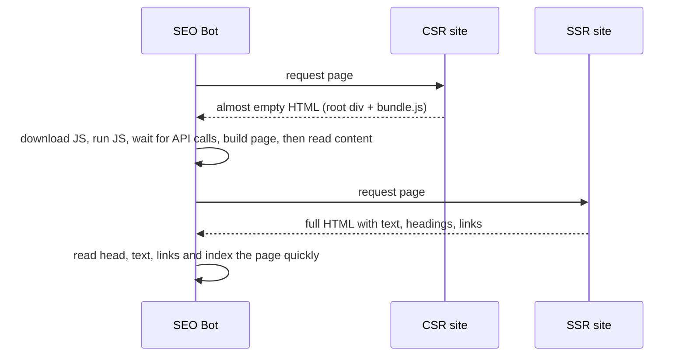

- **CSR:** the bot gets a page with almost no useful content. It has to download JS, run it, wait for API calls, render, and then read. Too much work.
- **SSR:** everything is already in the first HTML. The bot reads the head and text, finds links, and indexes quickly.

**Student question (Muthu Raj):** "In both cases we write the HTML. Why is SSR better for SEO?"
Answer: In CSR the final page is built **after** the bundle runs. The bot must wait for that. CSR does not mean "no SEO". SEO still works, but it is **harder**. In SSR the ready page comes directly, so the bot can read heading, text and links and move to the next page fast.

> **Extra (Staff level):** Modern Googlebot can run JavaScript, but it often does it **later in a second step**, so indexing can be slower. Many other bots (chat apps, social previews) do **not** run JavaScript at all.

<a id="s4_4"></a>

### 4.4 Static Site Generation (SSG)

**How it works:** HTML pages are made **at build time** and served as static files.
- Build: make HTML for all pages at once.
- Runtime: just serve the ready HTML.

**Examples:** blogs, documentation, marketing pages. Even the React docs: content changes rarely, yet SEO is very important.

**Good for:** content that rarely changes, maximum speed, SEO, CDN delivery. Server has almost no load.
**Not good for:** data that changes often, **personalized content** (everyone sees their own flavor on amazon.com, for example).

<a id="s4_5"></a>

### 4.5 Incremental Static Regeneration (ISR)

A mix of SSG and SSR. A nice technique.

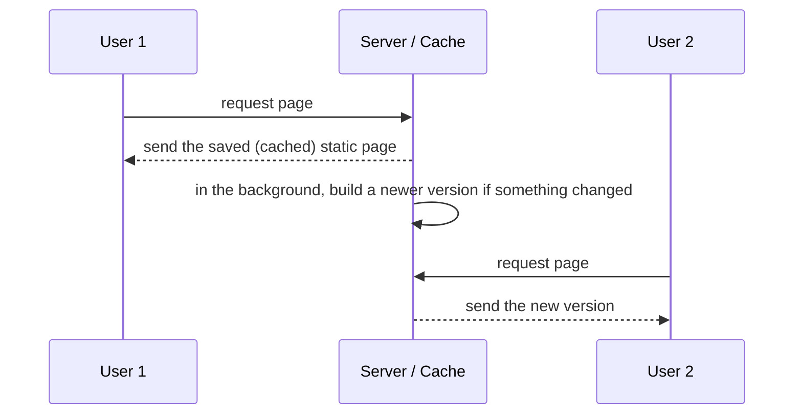

- User visits a page → gets the **cached static version** → after that, the backend **regenerates in the background** (after an interval) → **next user gets the updated page**.
- Instead of changing content on every request (SSR) or generating only once (SSG), it is **in the middle**.
- Examples: product catalog, blog lists, news feed updates. Only for **non critical** information. Critical data cannot be served this way.
- Best for: mostly static but sometimes updated content, high traffic pages, SEO with freshness.

**Student question:** "Can ISR regenerate at every request?" The speaker: no hard rule. You can do it every 5th request too. The common way is what is shown above: serve the saved page, build the next one in the background, serve it on the next request.

<a id="s4_6"></a>

### 4.6 Comparison

| | CSR | SSR | SSG | ISR |
|---|---|---|---|---|
| Where is page made | Browser | Server, **every request** | Server, **at build time** | Build time, then **refreshed in background** |
| SEO | Weak (harder) | Good | Good | Good |
| First load | Slow (full bundle) | Fast first content | Fastest | Fast |
| Server load | Low | High | Very low | Low |
| Fresh data | Yes (API) | Yes | No, until next build | Slightly late |
| Personal content | Good | Possible | Bad | Bad |
| Best use | Dashboards, Gmail, Trello | News, product pages | Blogs, docs, marketing | Catalog, blog lists, feed |

**Questions the interviewer can ask (speaker's list):** what are the 4 types, when to use each. SEO heavy? SEO not heavy? Very interactive? Content that does not change often but SEO heavy? Content that does not change often and not SEO heavy? If you know the four well, you can answer all of these.

**Quick answers**
- SEO heavy + changes often → SSR
- SEO heavy + rarely changes → SSG
- SEO heavy + changes sometimes, high traffic → ISR
- Not SEO + very interactive → CSR
- Rarely changes + not SEO → CSR or SSG both work (SSG gives speed from CDN)

<a id="s4_7"></a>

### 4.7 Can one app use many patterns?

**Student question (Saad):** In an e-commerce app, I want only the product catalog as ISR, not the full app. Is it possible?

**Speaker:** Yes, very common. The whole app is **not** rendered in one way.
- SEO heavy pages → server side.
- Settings page, profile page, non SEO pages → client side.
- A popular mix: the **landing (first) screen** from the server so the first page comes fast, and the less visited pages as client side.

**Follow up (Saad):** What if I use plain React (older versions, before server components)?
**Speaker:** The simplest way is to use the **Micro Frontend** idea. Build the part that needs server rendering (for example, product catalog) as a **separate MFE, deployed separately**, and download it on demand. The rest stays client side.

> **Extra (Staff level):** Frameworks like Next.js let you choose per route (SSR for one page, SSG for another, CSR for another) inside one app, so you do not need MFE just for this. MFE is the answer if you are stuck with plain React.

<a id="s4_8"></a>

### 4.8 Open question: "If SSR gives full HTML each time, why do I not see a page reload like old MVC sites?"

Student question (Param). The speaker said he would check and answer later, so there was no final answer in the session.

> **Extra (Staff level), simple answer:** Only the **first** request is a full HTML page from the server. After hydration, the framework takes over the links. When you click a link, it does **not** reload the browser. It fetches only the data (or a small chunk) for the next page and updates the screen in the browser, like a normal single page app. That is why Next.js feels smooth. A full page reload happens only if you type a new URL or refresh.

[⬆ Back to top](#top)

---

<a id="s5"></a>

## 5. Authentication vs Authorization

<a id="s5_1"></a>

### 5.1 The difference

| | **Authentication** | **Authorization** |
|---|---|---|
| Question | **Who are you?** | **What are you allowed to see or do?** |
| Example | You enter user ID and password, we check you are the right user | After login, an Admin sees user management, a normal user does not |
| Who handles | Mostly **backend / identity providers** | **Backend + frontend UI gating** |

- Frontend authorization is about **controlling what is visible**, stopping accidental access and improving UX.
- **Security must still be enforced on the backend.** (Remember this line.)

<a id="s5_2"></a>

### 5.2 RBAC: Role Based Access Control

- Users get **roles**. Roles have **permissions**. (Admin, Manager, User.)
- Example: on Amazon, you must be a **seller** to open the seller account. Admin can see the user management page. A normal user cannot see the admin panel.
- **How in frontend:** keep the role in auth state, use route guards, and conditional rendering. You find the role when the user logs in. You can store it in a cookie, local storage or other storage, depending on security needs.
- Simple idea: depending on the role, return only certain navigation items.

```js
function getNavItems(role) {
  const items = [{ name: "Home", path: "/home" }];
  if (role === "admin") items.push({ name: "User Management", path: "/admin/users" });
  if (role === "seller") items.push({ name: "Seller Account", path: "/seller" });
  return items;
}
```

| Advantages | Limits |
|---|---|
| Simple to think about | Becomes rigid |
| Easy to build | Hard for complex rules ("Admin level 2 and above, from this state only") |
| Works for most apps | **Role explosion** in big systems: too many roles |

Good when you can clearly separate flows by type of user.

<a id="s5_3"></a>

### 5.3 ABAC: Attribute Based Access Control

- More **granular**. Access depends on **attributes**, not only role.
- Attributes can be: user properties, resource properties, time, location, ownership.
- Example: *User can edit the document if user ID = owner ID and document status is not locked.*
- Think of it as a **small extension of RBAC**. Role alone cannot always say "can this user open this thing?", so we add attributes. Many companies build RBAC first and ABAC on top.

| Why it is powerful | Why it is harder |
|---|---|
| More flexible, more granular, content aware decisions | More logic, more rules to evaluate, harder to debug. The more layers, the harder to debug |

<a id="s5_4"></a>

### 5.4 Feature level access

- Controls access to **specific features**, not just pages.
- Examples: premium features only for paid users, beta features for selected accounts, permission to export data.
- Can be kept as a **feature permission matrix** (for example: this user has `export_data`, `analytics`).

<a id="s5_5"></a>

### 5.5 How they work together

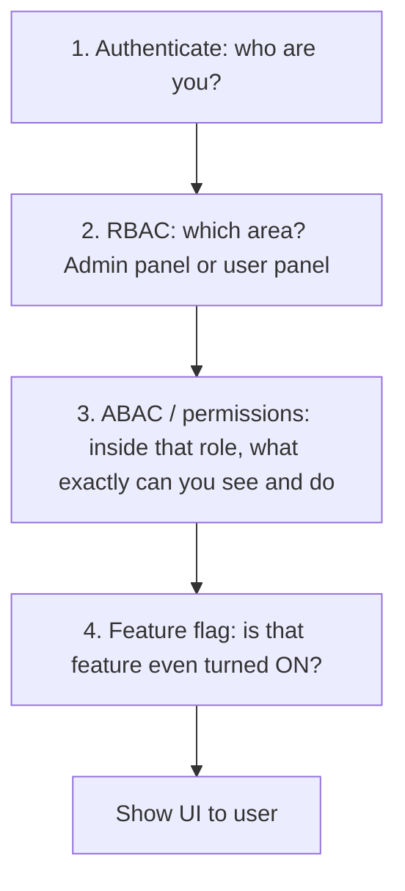

Summary in the speaker's words: authenticate the user, see what the role can see, then inside the role what you have access to, and finally the **last check**: even if you have access, the feature itself may not be enabled.

<a id="s5_6"></a>

### 5.6 System design rules for authorization

1. **UI must never be the source of truth.** Decisions come from the backend.
2. Backend returns **permission metadata** (a dedicated layer is fine).
3. UI renders based on **capabilities**, not on roles directly. (Example: show a button if `canExport` is true, not if role is "admin".)
4. Permissions should be **cacheable**.
5. Must support **dynamic updates**: if permissions change at runtime (an admin loses access), the UI should reflect it.

> **Extra (Staff level), WHY capabilities and not roles:** roles change names and meanings over time. A capability like `canExport` stays stable, so you do not rewrite UI code when business changes roles.

<a id="s5_7"></a>

### 5.7 Direct URL problem (Saad's question)

**Question:** I hide "User Management" in the navigation for non admins. But a user can type `/home/user-management` in the URL. How do I handle it? There can be many other ways to reach it.

**Speaker's answer:**
- Add **route protection (route level guard)** on the client. Check the role before opening the route. If not allowed, do not navigate and show an error.
- But be honest: in a React app the **full bundle is already on the client**. Anyone can read the code and with some effort change checks and reach `/admin`. It may not be easy, but it is **doable**.
- So the **real control must be on the backend.** Even if someone opens that page, the backend must return **no useful data** for that user ID or token. They see an empty page with nothing.
- Vaishali's team does the same: roles are passed to routes, checked on each page, and the backend also checks.

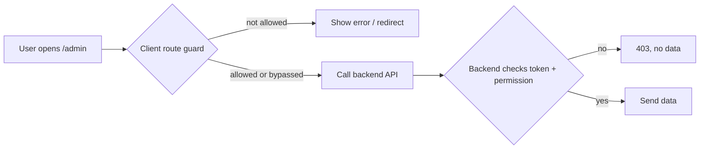

**WHY both:** client guard is for **good user experience**. Backend check is for **real security**.

[⬆ Back to top](#top)

---

<a id="s6"></a>

## 6. Feature Flags

<a id="s6_1"></a>

### 6.1 What is it and why use it?

- Even if the user has the **complete bundle** (which can show everything), you can **control which features are shown** using flags.
- A feature can be turned **ON or OFF** by a setting that comes from the **backend**.
- Just because code is in the bundle does **not** mean every user should see it.

**Use cases:**
- Beta test for only one region or only some users.
- Premium features only for some people.
- Roll out slowly.
- **Turn off a buggy feature without a new client deployment.** (Example: feature A has a bug, switch it off now, fix and deploy later.)

<a id="s6_2"></a>

### 6.2 Types of flags

| Type | Use |
|---|---|
| **Release flags** | Gradual rollout |
| **Experimental flags** | Alpha, beta tests. If comfortable, roll out. Else do not |
| **Operational flags** | Emergency switch to disable something |
| **Permission / entitlement flags** | Who is allowed (paid plan etc.) |

<a id="s6_3"></a>

### 6.3 How it works

- **Remote configuration:** feature states are stored on a remote server, for example `new_dashboard: true`, `max_upload: 10`, `beta_features: ...`.
- The client asks "is this feature enabled?" If yes, it renders the component. If no, it does not.
- While coding you write: *if this flag is true, show this feature. Else do not.*
- Flags can depend on: user ID, region, device, plan, experiment bucket.
- You can use an open source tool, a paid tool, or build your own. It depends on the company.

```js
const flags = await fetchFlags();         // from backend, once at login
function Dashboard() {
  return flags.newDashboard ? <NewDashboard /> : <OldDashboard />;
}
```

<a id="s6_4"></a>

### 6.4 Key design concepts

- **Startup latency and offline fallback:** flag values come from an API. What if the API does not load? Every flag check must have a **default value**.
- Config **caching**, **versioning**, **safe defaults**, **rollback strategy**.
- Reduces deployment risk, allows experiments, allows progressive delivery, allows runtime control.

<a id="s6_5"></a>

### 6.5 How big companies do it (speaker's story)

He said apps like Instagram and Twitter follow a rule (as he had read):
- A new feature is shipped in version **1.0** but **kept OFF** for everyone. It is only part of the bundle. This confirms nothing in the existing code breaks.
- In **2.0** they turn it on for a small group, for example a country where the app is used less. If there is no problem, they roll out slowly.
- **WHY:** the stake is very high. So many people use it, and it must not cause problems for anyone.

> Different companies follow different ways. Treat this as a good example of careful rollout, not as a fixed rule.

[⬆ Back to top](#top)

---


<a id="s7"></a>

## 7. Scenario 1: Feature flag changes while the user is using the feature

**Question (speaker, as a Staff or Lead):** A feature flag is updated remotely and now a feature must be hidden. But a user is **in the middle of a form, a checkout, a banking transaction, or editing a document**. How do you update the UI safely without breaking their state or flow?

This is a Type 2 (scenario driven) question.

### Answers from the room

| Who | Idea |
|---|---|
| Param, Saad | Check if the user is in the middle of the feature. Show a warning or message before disabling. Ask for consent. Handle it gracefully. Save the user's state. |
| Vimal | On every user action, check with the backend. If disabled, show an alert. |
| Shisha | In the same session do not change anything. Send the new build/config in the next session. |
| Parth | When the user next talks to the backend, we know if the feature is allowed and we can restrict at that point. |
| Ramya, Shivam | Fetch enabled features **once at login**. They work for that session. On refresh or reload they get new values. |

### Speaker's final answer

1. **Best idea: take the flags once at login (app start) and keep them for the whole session** until the user refreshes. Do not recompute during the session. There is no point disabling something the user already sees.
2. **Pick a non peak time to change flags.** Banking: midnight, hardly anyone transacts. E-commerce in one country: early morning.
3. If you **cannot wait** for the refresh (an urgent kill switch), then:
   - Have a **listener**, for example **Server Sent Events**, that waits for changes.
   - Have a **generic handler** that either **disables and shows a warning message**, or lets the **active session continue**.
4. Remember the three terms from his slide: **lag evaluation boundary**, **sticky session flags**, **graceful degradation**.

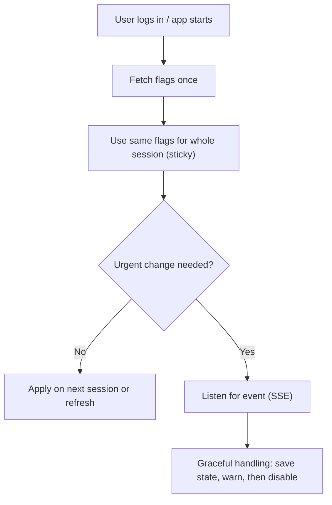

> **Extra (Staff level):**
> - Say the words **"sticky for the session"** and **"kill switch"**. They show you know the normal case and the emergency case.
> - Even with sticky flags, the **backend must still check** on the action. If the user clicks "pay" on a disabled feature, the backend can say no, and the UI shows a friendly message and keeps their data.
> - **WHY not change live:** users lose typed data and trust. A silent change in a payment flow is a big risk.

[⬆ Back to top](#top)

---

<a id="s8"></a>

## 8. Scenario 2: Logout from one tab

**Question:** User is logged in on 3 tabs (for example notion.com). User logs out from Tab 1. The other tabs still think the user is logged in. That is a **security risk**. How do you fix it? (Expected: how Google does it. Log out of Gmail and YouTube also logs you out.)

### Answers from the room

| Who | Idea | Speaker's view |
|---|---|---|
| Muthu Raj | Cookie holds the token. Logout ends the session. Other tabs get logged out as the session ended. | "Nothing happens automatically." Other tabs show the page until something triggers. Also backend usually does not track invalid tokens. |
| Vimal | On every user action, verify active status with backend. | Works, but not what is expected. |
| Akash | Use Server Sent Events and show a pop-up in all tabs. | Works, but not the right approach. |
| Shisha | Next API call returns an error, handle it gracefully. | Good thought. But switching tabs may not make an API call, so the user stays visible as logged in. |
| Ramya | Token expires in cookie, other tabs use same cookie. | Right, they share the cookie. |
| Param | **Broadcast a logout event** to all tabs. | The speaker's pick. |

### Speaker's reasoning, step by step

1. **Logout API call:** the user clicks logout in Tab 1 and the app calls the backend logout API.
2. **Backend clears the cookie.** Backend controls cookies, so as a response it sets the cookie empty. Now there is no cookie for any tab.
3. **Why this alone is not enough:** a token can be valid for 3 minutes. If the user logs out at minute 1, the token is still valid for 2 more minutes. Backend cannot call it invalid because that means tracking every bad token. Good backends do not work that way. Token checks are often done in a layer in the middle (like an API proxy).
4. **Other tabs do not know** until they make an API call. Switching tabs may not make a call.
5. **Right answer: broadcast an event.** Tab 1 sends a "logout" event. Every other tab listens (the root / navigation level listens). When it hears it, it **forcefully logs the user out** (clears state and goes to login).
6. **Backup: handle 401.** On the next API call, if backend sends **401 Unauthorized**, log the user out. Good as a second layer.

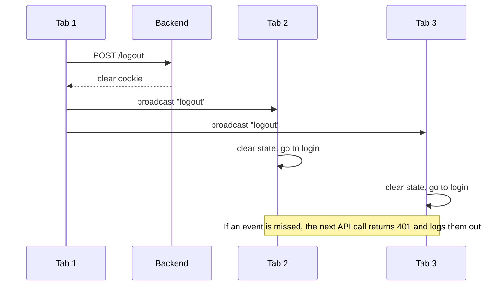

> **Extra (Staff level):**
> - The speaker said "you can consider Redux." Be careful: **Redux state lives inside one tab**, so it does not reach other tabs by itself. For tabs, use the browser's **BroadcastChannel** (or the `storage` event as a fallback for older browsers).
> ```js
> const channel = new BroadcastChannel("auth");
> // Tab 1 after logout API success
> channel.postMessage({ type: "LOGOUT" });
> // Every tab
> channel.onmessage = (e) => {
>   if (e.data.type === "LOGOUT") { clearAppState(); window.location.href = "/login"; }
> };
> ```
> - Fallback: write to `localStorage` (for example a `logout` key). Other tabs get the `storage` event.
> - Short token life + refresh token reduces the risk window. Backend can also keep a small deny list for sensitive apps (banks).
> - Also log out when the tab becomes visible again (`visibilitychange`) and check session once.
> - **WHY layers:** event = instant. 401 = safety net. Cookie cleared = server side truth.

[⬆ Back to top](#top)

---

<a id="s9"></a>

## 9. Homework Scenarios

The speaker left these two for you to study. There was no answer in the session. The thoughts below are **Extra (Staff level)** to help you start.

<a id="s9_1"></a>

### 9.1 Upgrading the app while a user is in the middle of a transaction

*Problem:* Banking app V1 is running. You release V2. A user is in the middle of a transaction. How do you update?

Ideas to cover:
- **Do not force a reload** in the middle of a transaction. Let the user finish.
- Detect a new version (poll a small version file, or get an event). Show **"New version available. Update after you finish"**, and update at a safe moment (after the transaction, on next navigation, or next login).
- Old JS files must **stay available for some time** on the server/CDN. If you delete them, the old tab fails when it lazy loads a chunk.
- Keep the **API backward compatible** (versioned) so V1 and V2 can both talk to the backend for some time.
- Use feature flags to turn on risky new flows slowly.
- Pick a low traffic time for the release.

<a id="s9_2"></a>

### 9.2 Frequent URL changes, how do you handle API calls?

*Problem:* Backend API URLs change often. How do you handle the API calls in the frontend?

Ideas to cover:
- Never write full URLs all over the code. Keep them in **one place** (one API client or config file).
- Use a **base URL** from environment or **remote config**, so a change does not need a code change.
- Put a **gateway or proxy** in front, so the frontend talks to a stable URL and the backend can move behind it.
- Use **API versions** (`/v1`, `/v2`) and keep old ones for some time.
- Agree on the contract in a shared document, and use contract tests so a change is caught early.
- For MFE: the platform team owns the common API library, so one fix updates every app.

[⬆ Back to top](#top)

---

<a id="s10"></a>

## 10. Axios vs Fetch

**Question (Ramya):** Which one is good to use?

**Speaker's answer:**
- Axios had some advantage because of the extra layers it gave (for example for older browsers, like Internet Explorer).
- Fetch can do everything Axios does. Behind the scenes Axios is also using the same base.
- If you start a project from scratch, **do not add a library unless you truly need it.** This also applies to Redux and many other things.
- Earlier, writing the extra boilerplate code was difficult. **Now with GenAI it is easy**, so he suggests building with **Fetch only**.

> **Extra (Staff level):** If you use Fetch, write **one small wrapper** in one place that handles base URL, auth header, JSON parsing, error codes (like 401) and retries. That wrapper replaces what Axios gave you, and it connects with the earlier points: one place for API calls, one place for token handling.

```js
async function api(path, options = {}) {
  const res = await fetch(`${BASE_URL}${path}`, {
    credentials: "include",
    headers: { "Content-Type": "application/json", ...options.headers },
    ...options,
  });
  if (res.status === 401) { broadcastLogout(); throw new Error("Unauthorized"); }
  if (!res.ok) throw new Error(`API error ${res.status}`);
  return res.json();
}
```

[⬆ Back to top](#top)

---

<a id="s11"></a>

## 11. Cheat Sheet

**Interview types**
- Type 1 deep dive (10+ years, premium) · Type 2 scenarios (mid tier) · Type 3 fix an existing system.
- Do not guess how the company built it. Do not argue. Be open to change.

**Architecture**
- Monolithic = one codebase, one build, ships together. **Default start.**
- Micro Frontend = independent apps, own team, deployed separately, loaded in a container at runtime.
- Use MFE only for: shared UI across apps, or teams spread across the world.
- MFE needs a platform team, a common API library, shared state contract, and good communication.

**Repo**
- Monorepo = one Git repo. Polyrepo = many repos. **Not the same as monolithic / MFE.**
- Many repos can still ship one bundle (versions in package.json).
- Path: monolithic + one repo → monolithic + many repos → MFE only for the module that needs it.

**Rendering**

| Need | Pick |
|---|---|
| Interactive, login needed, no SEO | CSR |
| SEO + fresh data each request | SSR |
| SEO + rarely changes | SSG |
| SEO + changes sometimes + high traffic | ISR |
| Mixed app | Different pattern per page |

**Access**
- Authentication = who. Authorization = what.
- RBAC (role) → ABAC (attributes) → feature level → feature flag.
- UI hides things for UX. **Backend enforces for security.**

**Feature flags**
- Remote config, safe defaults, sticky for the session, kill switch with a listener, off peak changes.

**Scenarios**
- Flag change mid use: fetch once at login, keep for session, warn if you must change.
- Logout in many tabs: backend clears cookie + broadcast event + 401 as backup.

**Tools**
- Fetch over Axios unless you truly need a library.

[⬆ Back to top](#top)

---

<a id="s12"></a>

## 12. Rapid-Fire Q&A

**Q1. How many types of system design interviews are there?**
Three: deep dive on one system, scenario driven questions, and debugging or improving an existing system.

**Q2. Is there an LLD round in frontend?**
Not a separate one. The machine coding round is like the LLD round. System design is mostly HLD, and sometimes pseudocode or a small prototype.

**Q3. What do you do if the interviewer suggests a different approach?**
Look at the merits of their approach. Do not argue. If it is better, take it. That is how it works in a real company.

**Q4. Monolithic or Micro Frontend, which one?**
Start monolithic. Move to MFE only when a module is shared by many apps or teams are spread across the world, because MFE adds technical, communication and management cost.

**Q5. How do MFEs share state and tokens?**
A platform team owns a common API library and shared state (like a Redux store with slices). Teams agree on events and params as contracts. The container owns authentication.

**Q6. Is monorepo the same as monolithic?**
No. Monorepo is where the code is stored. Monolithic is how the app is built and shipped. A polyrepo can still produce a monolithic app using versions in package.json.

**Q7. How does a polyrepo become one bundle?**
Each repo publishes a version. The container lists them in package.json. `npm install` pulls them into node_modules. Build makes one bundle.

**Q8. CSR vs SSR?**
CSR sends a bundle and the browser builds the page: good for interactive apps, weak for SEO, slow first load. SSR builds the HTML on the server for each request: good for SEO and first content, but costs server work.

**Q9. Why is SSR better for SEO?**
The bot gets full HTML at once. In CSR it must download and run JavaScript and wait for APIs before it can read anything.

**Q10. SSG vs ISR?**
SSG makes pages once at build time. ISR serves the saved page, then rebuilds in the background so the next user gets the new one.

**Q11. Can one app use different rendering for different pages?**
Yes, and it is common. SEO pages on the server, personal or settings pages on the client.

**Q12. Authentication vs authorization?**
Authentication checks who you are. Authorization decides what you can see and do.

**Q13. RBAC vs ABAC?**
RBAC uses roles. ABAC uses attributes like owner, status, time, location. ABAC is more flexible but harder to debug.

**Q14. A user types an admin URL directly. How do you stop them?**
A client route guard for UX, and real checks on the backend so no data is returned.

**Q15. What is a feature flag and why use it?**
A remote ON or OFF switch for a feature. It allows gradual rollout, experiments and a quick kill switch without a new deployment.

**Q16. A flag changes while a user is using the feature. What do you do?**
Fetch flags once at login and keep them for the session. Change at off peak time. For urgent cases, listen for an event, warn the user, and handle it gracefully.

**Q17. Logout in one tab, how do other tabs know?**
Backend clears the cookie, the tab broadcasts a logout event, and a 401 on the next API call is the backup.

**Q18. Axios or Fetch?**
Fetch. Avoid extra libraries unless truly needed. Wrap Fetch in one helper.

**Self test (say these out loud)**
1. Draw monolithic vs micro frontend for Amazon or Paytm and name when you would choose each.
2. Explain monorepo vs polyrepo vs monolithic vs MFE in one minute without mixing them.
3. Explain the 4 rendering patterns with one example each.
4. Draw the 4 layers: authentication, RBAC, ABAC, feature flag.
5. Walk through the multi tab logout answer in steps.

[⬆ Back to top](#top)

---

<a id="s13"></a>

## 13. Coverage Checklist

| Topic in the session | Where |
|---|---|
| Recap of weeks, resume review, start of placement work | Skipped (not technical) |
| Three types of system design interviews, examples, who gets which | [1.1](#s1_1), [1.4](#s1_4) |
| HLD vs LLD in frontend, Microsoft type ahead story | [1.2](#s1_2) |
| Pseudocode | [1.3](#s1_3) |
| Two golden rules (do not guess, do not argue) | [1.5](#s1_5) |
| Why architecture, monolithic | [2.1](#s2_1), [2.2](#s2_2) |
| Micro Frontend, Paytm example, settings reuse | [2.3](#s2_3) |
| Pros and cons, operations challenge | [2.4](#s2_4) |
| State sharing, platform team, Redux slices | [2.5](#s2_5) |
| Auth in MFE | [2.6](#s2_6) |
| How to divide MFEs, when not to use | [2.7](#s2_7), [2.8](#s2_8) |
| Module federation | [2.9](#s2_9) |
| Monorepo vs polyrepo, not same as architecture | [3.1](#s3_1), [3.2](#s3_2) |
| Polyrepo still monolithic via package.json | [3.3](#s3_3) |
| Growth path | [3.4](#s3_4) |
| Comparison and Stack Overflow story | [3.5](#s3_5), [3.6](#s3_6) |
| CSR, SSR, SEO, SSG, ISR | [4.1](#s4_1) to [4.5](#s4_5) |
| Mixing rendering patterns | [4.7](#s4_7) |
| Param's "no reload" question | [4.8](#s4_8) |
| Authentication vs authorization, RBAC, ABAC, feature level | [5.1](#s5_1) to [5.4](#s5_4) |
| Layers together and design rules | [5.5](#s5_5), [5.6](#s5_6) |
| Direct URL question | [5.7](#s5_7) |
| Feature flags, types, how they work, design, big company rule | [6](#s6) |
| Scenario: flag change mid session | [7](#s7) |
| Scenario: logout from many tabs | [8](#s8) |
| Homework: upgrade mid transaction, URL changes | [9](#s9) |
| Axios vs Fetch | [10](#s10) |
| Tomorrow's plan: security vulnerabilities, ways to make API calls, live system | Next session (not covered here) |
| ChatGPT as a companion talk, AI mock interview, personal side talk | Skipped (not technical) |

*Revision tip: first do the self test, then read only the **Extra (Staff level)** blocks the day before the interview.*

[⬆ Back to top](#top)
